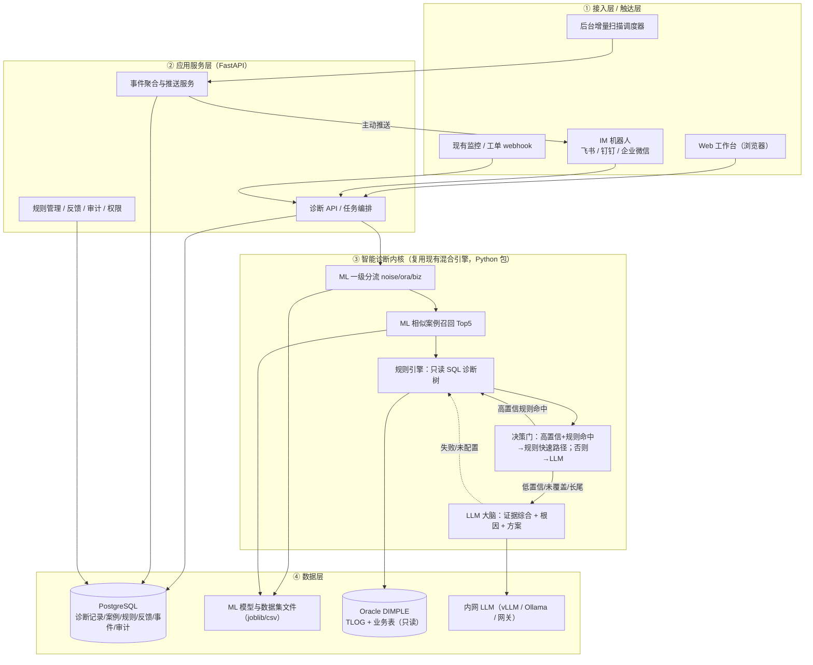
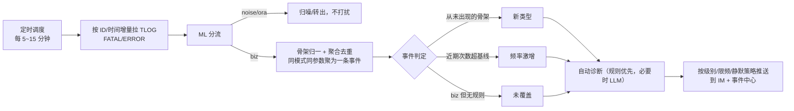
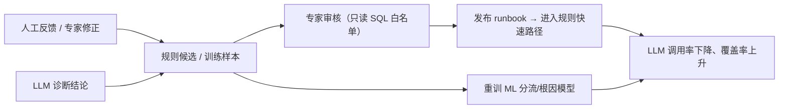
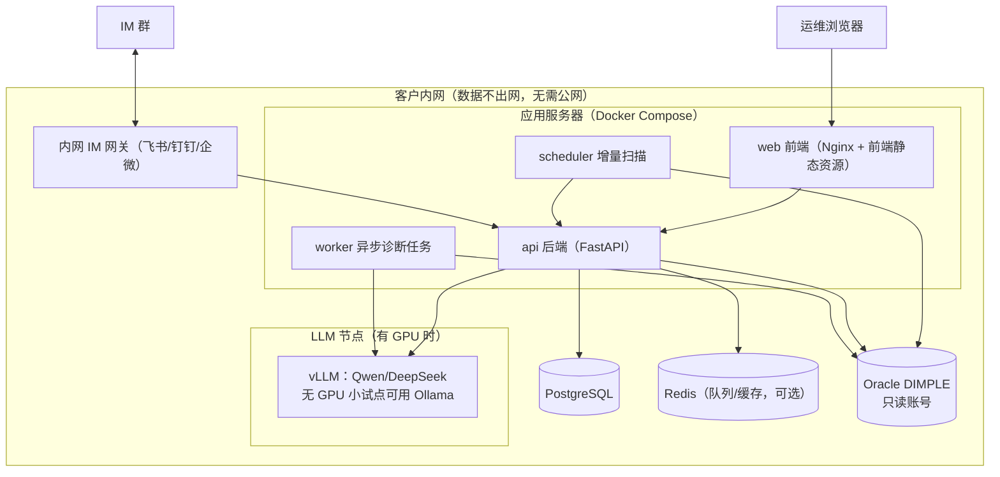

# 数据库业务报错智能诊断系统 · 产品形态设计文档

## 私有化内网 Web 工作台（交付主体）+ IM 机器人（入口/触达）+ 日志增量扫描推送 + 诊断 API

> 适用项目：DIMPLE 期货/黄金清算系统（Oracle `10.253.162.172:1521/dmpdb`）数据库业务报错智能诊断
> 技术基座：已在真实 TLOG 跑通的混合引擎（**LLM 为大脑 + ML 入口分流/相似召回 + 规则只读查库**），本设计是在其之上的产品化
> 文档版本：v1.0　|　日期：2026-10-21　|　状态：方案评审稿

---

## 一、产品形态总览与选型结论

### 1.1 一句话结论

> **交付主体是一个私有化部署在内网的 Web 诊断工作台；后台做日志增量扫描实现"新报错/激增/未覆盖"主动推送；后期开放诊断 API 嵌入客户现有监控与工单。**

### 1.2 交互模式：按需诊断为主，轻量推送为辅

- **主轴＝按需自助诊断**：运维拿到报错 → 在 Web 搜索或 IM 发问 → 秒级拿到"问题+方案+证据"。
- **增值＝主动事件推送**：不做实时盯指标，而是每若干分钟增量扫 TLOG，把业务报错中**新出现的类型、频率激增、规则未覆盖**的事件主动推给运维——"报错发生后，带着答案找人"。

### 1.3 为什么是 Web，而不是桌面软件

金融内网多人协作、需要审计和知识沉淀，B/S 全面优于 C/S：

| 维度 | 私有化 Web 工作台（推荐） | 桌面客户端 C/S（不推荐） |
|---|---|---|
| 安装/升级 | 服务端一次部署，全员浏览器即用 | 逐台安装，升级成本高、版本混乱 |
| 数据共享 | 诊断记录、案例库、规则集中共享 | 数据散落在各人机器 |
| 多人协作/审计 | 天然支持账号、权限、审计、审批 | 难以实现 |
| 知识库沉淀 | 统一 PG，越用越准 | 无法集中沉淀 |
| 与 IM/工单集成 | 服务端天然可集成 | 困难 |

### 1.4 为什么不做实时监控大屏

实时指标监控是成熟赛道（夜莺、Prometheus、Datadog 等），重复造轮子且与"已知报错查根因"定位不符。本系统只做**日志侧的增量扫描**，复用现有告警/监控体系，不替代它。

### 1.5 对标产品形态

| | **D-Bot（清华，VLDB'24 / SIGMOD demo）** | **OpenSRE（Tracer-Cloud）** |
|---|---|---|
| 产品性质 | 开源研究项目，非商业 SaaS | 开源（GitHub/PyPI，Docker 自托管）+ 商业 Cloud 双形态 |
| 部署 | 本地 Web 服务（前端复用 Chatchat） | Docker 自托管（web/gateway/scheduler + Postgres/Redis）或托管云 app.tracer.cloud |
| 入口 | 浏览器 Web UI | Web UI + Slack/Teams 机器人 + CLI |
| 触发 | 按需诊断（给异常出报告，可回溯推理） | 告警驱动、持续运行，结论推回 IM |
| 我们学什么 | **私有化 Web 诊断工作台**形态、报告 + 推理回溯 | **IM 入口 + 主动推送 + 嵌入现有工具链**、自托管三组件拆分 |

> 结论：**"诊断交互"对标 D-Bot，"触达与集成"对标 OpenSRE。**

---

## 二、目标用户与使用场景

### 2.1 角色

| 角色 | 主要诉求 |
|---|---|
| 一线运维 / 清算支持 | 报错了马上知道什么意思、怎么处理，最好群里直接问 |
| DBA / 资深工程师 | 看证据链、确认根因、处理长尾、维护规则与知识库 |
| 运维主管 | 覆盖率、高频问题、趋势、未覆盖盲区、处置效率 |
| 系统管理员 / 安全 | 私有化、账号权限、只读、审计、密钥、数据不出网 |

### 2.2 核心场景（用户故事）

1. **报错后主动查**：清算报"持仓不足"，运维打开 Web 工作台，输入 TLOG ID（或粘贴报错文本），秒级看到结论、可平量核对结果、相似历史和分步骤处置建议。
2. **群里直接问**：运维把报错截图/ID 丢进 IM 群并 @机器人，机器人回一张诊断卡片（问题、置信度、关键证据、"查看详情"跳转 Web）。
3. **系统主动发现**：凌晨结算批量报错，增量扫描聚合出"某类费率缺失 10 分钟内出现 30 次，属未覆盖类型"，主动推送到值班群并附带一次自动诊断。
4. **告警/工单触发**：现有监控把含 TLOG ID 的告警以 webhook 推给诊断 API，结论自动回写到工单/告警评论。
5. **专家沉淀知识**：DBA 在工作台对高频报错审核/编辑 runbook，确认后该类问题进入规则快速路径（零 token）；对 LLM 结论点"有用/无用"并修正，回流训练。

---

## 三、总体逻辑架构



**关键设计原则**：智能诊断内核（`engine/`、`ml/`、`llm/`、`hybrid_diagnose.py`）**完全复用、不改算法**，产品层只在外围包服务、加存储、做界面。

---

## 四、功能模块设计

### 4.1 Web 诊断工作台（交付主体）

| 模块 | 功能 |
|---|---|
| **首页总览** | 今日报错量、待处理事件、业务报错占比、规则覆盖率、LLM 调用率、Top 高频类型、系统健康 |
| **诊断查询** | 三种输入：① TLOG ID；② 粘贴报错文本/截图 OCR；③ 时间范围 + 错误码/位置筛选。支持强制规则/强制 LLM |
| **诊断报告页** | 见 4.2 报告结构 |
| **历史诊断** | 列表 + 多条件筛选 + 全文检索 + 导出（PDF/Markdown），可复跑、可转工单 |
| **事件中心** | 增量扫描产生的事件：新类型、激增、未覆盖；支持确认、认领、静默、关闭 |
| **统计看板** | 类型分布、趋势、模块分布、规则覆盖率、未覆盖 TopN、LLM 调用率与成本、人工反馈准确率 |
| **规则/知识库管理** | runbook 列表、新建/编辑、只读 SQL 白名单、在线测试、版本、提交-审核-发布、停用 |
| **系统管理** | 数据源配置、LLM 开关与模型版本、IM 配置、推送策略、账号角色（RBAC）、审计日志 |

### 4.2 诊断报告页结构（核心输出，"问题是什么 + 怎么解决"）

```
┌─ 报错摘要 ────────────────────────────────────────┐
│ 时间 / 错误码 / 位置(包.过程:行号) / 结构化参数     │
├─ 结论卡（最醒目）──────────────────────────────────┤
│ 问题是什么：买方向持仓不足，Au(T+N1) 平仓超可平量，尚缺1手 │
│ 怎么解决：  1. 核对可平量  2. 查重复平仓/方向选反    │
│           3. 按可平量调减后重提                     │
│ 置信度：0.96   来源：规则快速路径（零 token）       │
├─ 证据链（可展开、可复跑）──────────────────────────┤
│ 只读 SQL：查询语句 + 返回结果 + 数据日期            │
│ 相似案例：Top5（相似度/历史次数/最近日期/错误码）    │
│ LLM 推理过程（走 LLM 时可回溯）                     │
├─ 操作 ────────────────────────────────────────────┤
│ 有用 / 无用（修正） │ 转专家 │ 转工单 │ 复制结论     │
└───────────────────────────────────────────────────┘
```

- 报告全程标注每一步由 **ML / 规则 / LLM** 完成，**可审计、可复核**；
- LLM 结论必须附查库证据，证据不足时如实给低置信度并给排查方向，**禁止臆测、禁止改库**。

### 4.3 IM 机器人（入口与触达）

- **被动问答**：@机器人 发送 ID/文本/截图 → 回诊断卡片（结论摘要 + 置信度 + 关键证据 + 链接到 Web 详情）；
- **主动推送**：事件中心的高优事件聚合后定时/实时推送到值班群；
- **轻交互**：卡片按钮"有用/无用/转专家/查看详情/静默此类"；
- **定位**：卡片是"轻结论"，完整证据链和管理动作仍在 Web。

### 4.4 日志增量扫描与推送服务



- 推送治理：分级、聚合、限频、静默，避免刷屏和告警疲劳；
- 基线与阈值为简单统计（同骨架近 N 日同时段均值 + 倍数），不依赖 LLM。

### 4.5 诊断 API（开放集成，后期）

- `POST /api/diagnose`：入参 `{id}` 或 `{text}`，返回结构化结论（含证据、来源、置信度）；
- `POST /api/feedback`、`POST /api/events/{id}/ack`；
- 鉴权：内网 SSO 或 API Key；提供 OpenAPI/Swagger 文档；
- 供监控告警（夜莺/AlertManager）、ITSM/工单系统、内部运维门户调用。

### 4.6 知识沉淀 / 数据飞轮（让系统越用越准）



---

## 五、部署架构（私有化内网）



- **小规模（POC / 单一系统）**：一台服务器 Docker Compose 即可（web/api/scheduler/worker + PG）；LLM 对接内网统一网关或用小模型，无需独立 GPU；
- **规模放大**：组件拆分（对标 OpenSRE 的 web/gateway/scheduler）、worker 水平扩展、上 K8s、检索升级为 pgvector/Milvus；
- **LLM 策略**：客户内网私有化部署，兼容现有 OpenAI 接口（`.../v1`）；无 LLM 或关闭时整套系统自动降级为纯规则，**离线可用、能力不中断**。

---

## 六、技术栈选型

| 层 | 选型 | 说明 |
|---|---|---|
| 后端 | **FastAPI** + Pydantic | 直接包现有 `engine/ml/llm`，Python 原生、改造量最小；自动 OpenAPI 文档 |
| 异步/调度 | P1 用 **APScheduler**；规模化换 **Celery + Redis** | 增量扫描、批量诊断、推送任务 |
| 前端（快版） | **Streamlit**（或 Gradio） | 几天出可演示 POC，便于给领导看效果 |
| 前端（正式） | **Vue 3 + Element Plus**（或 React + Ant Design） | 工作台、报告页、看板、管理后台 |
| 业务存储 | **PostgreSQL** | 诊断记录、案例、规则、反馈、事件、审计；中文检索可用内置全文/分词 |
| 相似检索 | P1 复用现有 **sklearn 内存索引**（启动加载 dataset）；量大后升级 **pgvector** | 与当前 retriever 一致，平滑替换 |
| 智能内核 | **scikit-learn（CPU 毫秒级）** + 规则引擎 + LLM | 已就绪，模型仅约 1.7MB |
| LLM | 内网 **vLLM**（Qwen/DeepSeek），小试点 **Ollama**；统一 OpenAI 兼容 | 复用 `llm/client.py`，只换 base_url |
| IM | 企业微信/钉钉/飞书 机器人 webhook + 回调 | 按客户实际办公平台选 |
| 数据库 | **python-oracledb thin，只读**，代码层写拦截 | 已就绪 |
| 部署 | **Docker Compose**（→ K8s） | 内网一键部署，附离线镜像与初始化脚本 |
| 鉴权 | 内网 SSO / LDAP / AD + RBAC | 审计可追溯到人 |

> 生产建议 Python 运行版本以 3.11/3.12 稳定版为准（当前开发机为 3.14，依赖均已适配；正式发布前在目标版本回归一次）。

---

## 七、分阶段落地路线（Roadmap）

| 阶段 | 内容 | 关键交付 | 验收标准 |
|---|---|---|---|
| **P0（已完成）** | CLI 混合 MVP + 真实 LLM 验证 | 诊断引擎、ML 模型、3 个 runbook、报告、成本测算 | 真实报错可出"问题+方案+证据"，分流准确率 ≥99.7% |
| **P1 Web 工作台 MVP**（约 2–4 周） | FastAPI 包现有引擎；Streamlit 快速版；PG 落库；诊断查询/报告/历史 | 可浏览器输入 ID/文本诊断、报告可查历史 | 覆盖现有 7 条样例，结论与 CLI 一致；规则路径 <1s |
| **P2 正式工作台**（约 +2–3 周） | 正式前端、事件中心、统计看板、规则管理后台、登录/权限 | 看板 + runbook 审核发布流程 | 专家可在界面新增/发布规则；覆盖率/LLM 占比可见 |
| **P3 IM + 增量推送**（约 +2–3 周） | 定时增量扫描、事件聚合、IM 机器人问答与推送 | 群里可问、可收到事件推送 | 新类型/激增/未覆盖可被检出并推送；限频不刷屏 |
| **P4 私有化与集成**（约 +3–4 周） | Docker Compose 离线部署、内网 LLM 接入、SSO/RBAC/审计、诊断 API、嵌工单 | 一键部署包、OpenAPI、工单回写 | 客户内网离线可用；LLM 可关；审计可追溯 |

**并行推进**：按 Top30 补 runbook（LLM 生成、专家审核，覆盖业务 93.5%）；上线后积累反馈，启动数据飞轮。

---

## 八、风险与对策

| 风险 | 影响 | 对策 |
|---|---|---|
| 规则覆盖率不足（长尾） | 长尾依赖 LLM、成本与稳定性 | 飞轮回流 + 专家补 Top30；LLM 兜底并标低置信；未覆盖事件主动暴露 |
| 内网 LLM 效果/算力 | 复杂根因质量 | 选合适尺寸开源模型；仅长尾走 LLM（0.4% 量级）；可配置开关、可降级 |
| 数据快照不同步（测试库停 8/28） | 旁证日期偏差 | 生产同库即解决；保留"参数日期 + 目标表 MAX 日期"旁证 |
| 误报/推送打扰 | 运维反感 | 聚合、分级、限频、静默、基线统计 |
| 客户对大模型的顾虑 | 交付受阻 | 全私有化、可一键关闭、降级纯规则、全程只读、可审计 |
| 越权写库风险 | 安全事故 | 只读账号 + 代码层写拦截 + 规则 SQL 白名单，三重约束 |

---

## 九、结论与建议

1. **产品形态锁定"私有化内网 Web 工作台 + IM 机器人入口 + 增量扫描推送"**，不做桌面软件、不做实时监控大屏；
2. 智能内核复用已跑通的混合引擎，**产品化是"包服务 + 做界面 + 加调度/存储/集成"**，风险可控、周期短；
3. 先用 **Streamlit 快速版给领导和客户演示效果**，确认价值后再投入正式前端与私有化部署；
4. 价值闭环的关键是**规则覆盖率 + 数据飞轮**，让系统越用越准、越用越省 LLM。

> 下一步建议：先按 P1 把 FastAPI + Streamlit 工作台搭起来（现有引擎可直接封装），用真实报错做一次可点击的端到端演示。
