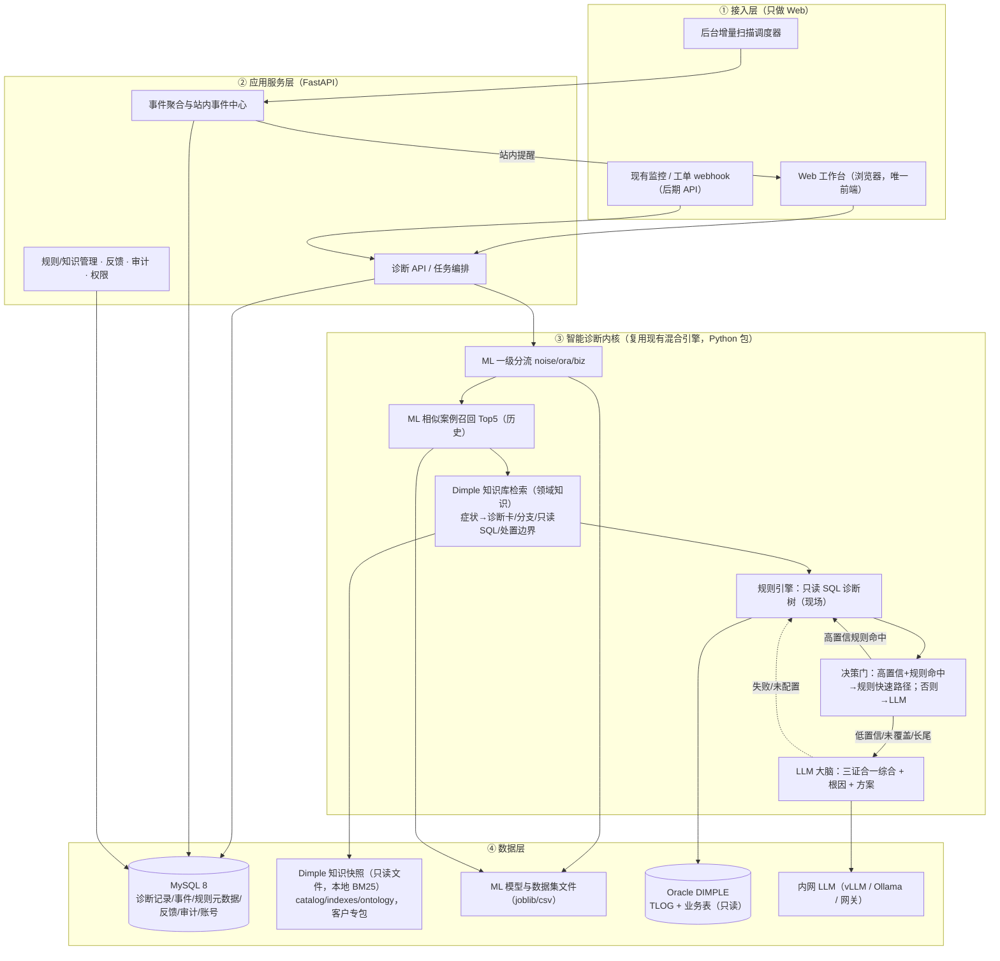
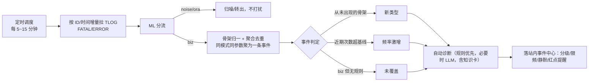
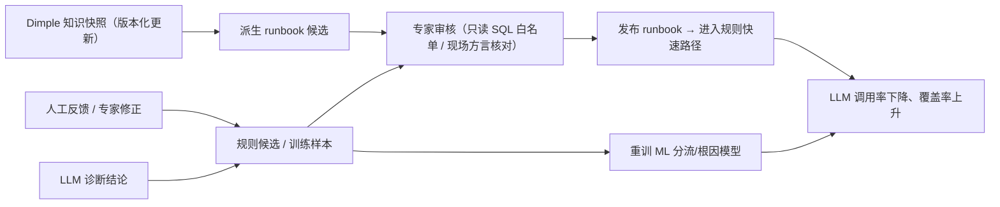
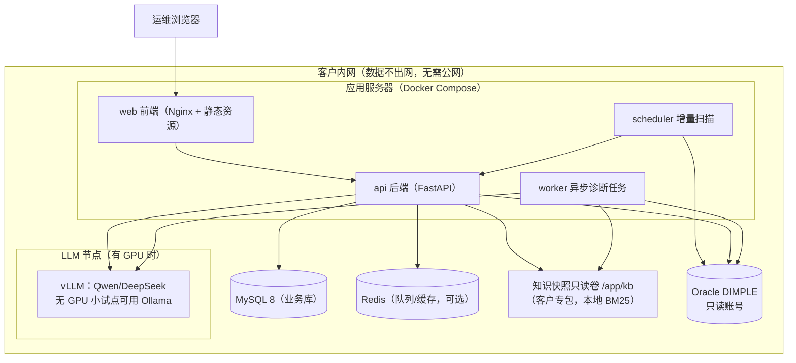

# 数据库业务报错智能诊断系统 · 产品形态设计文档

## 私有化内网 Web 诊断工作台（唯一前端）+ 站内事件中心 + 诊断 API

> 适用项目：DIMPLE 期货/黄金清算系统（Oracle `10.253.162.172:1521/dmpdb`）数据库业务报错智能诊断
> 技术基座：已在真实 TLOG 跑通的混合引擎（**LLM 为大脑 + ML 入口分流/相似召回 + 规则只读查库 + Dimple 知识库领域知识层（三证合一）**），本设计是在其之上的产品化
> 文档版本：v2.0　|　日期：2026-10-21　|　状态：方案评审稿（纯 Web、业务存储 MySQL、已并入知识库）

---

## 一、产品形态总览与选型结论

### 1.1 一句话结论

> **交付主体是一个私有化部署在内网的 Web 诊断工作台（唯一前端）；后台做日志增量扫描，在"站内事件中心"对新报错/激增/未覆盖做主动提醒；后期开放诊断 API 嵌入客户现有监控与工单。不做 IM 机器人、不做桌面软件、不做实时监控大屏。**

### 1.2 交互模式：按需诊断为主，站内事件提醒为辅

- **主轴＝按需自助诊断**：运维拿到报错 → 在 Web 工作台输入 TLOG ID 或粘贴文本 → 秒级拿到"问题 + 方案 + 证据"。
- **辅助＝站内事件中心**：不做实时盯指标，每若干分钟增量扫 TLOG，把业务报错中**新出现的类型、频率激增、规则未覆盖**的事件聚合到工作台的事件中心（登录可见、可认领/静默），做到"报错发生后，带着答案等人来看"，**不向 IM 群推送**。

### 1.3 为什么是 Web，而不是桌面软件

金融内网多人协作、需要审计和知识沉淀，B/S 全面优于 C/S：

| 维度 | 私有化 Web 工作台（推荐） | 桌面客户端 C/S（不推荐） |
|---|---|---|
| 安装/升级 | 服务端一次部署，全员浏览器即用 | 逐台安装，升级成本高、版本混乱 |
| 数据共享 | 诊断记录、案例、规则、知识集中共享 | 数据散落在各人机器 |
| 多人协作/审计 | 天然支持账号、权限、审计、审批 | 难以实现 |
| 知识沉淀 | 统一 MySQL + 知识快照，越用越准 | 无法集中沉淀 |
| 统一入口 | 浏览器一处访问，无外部平台依赖 | 无 |

### 1.4 为什么不做 IM 机器人

- 客户内网 IM 平台各异（飞书/钉钉/企业微信），机器人接入需逐平台申请网关、外发审批和安全评估，**落地成本高、周期长**；
- 核心诉求是"已知报错查根因"，Web 工作台已完整满足；主动提醒用**站内事件中心**即可（登录可见、可配邮件兜底），不依赖任何 IM；
- 去掉一个外部入口和依赖，P1 更快上线、攻击面更小、更易过合规；
- **保留扩展位**：后期开放诊断 API 后，若客户确有需要，可由客户/集成方在 API 之上自行接 IM，系统本身不内置。

### 1.5 为什么不做实时监控大屏

实时指标监控是成熟赛道（夜莺、Prometheus、Datadog 等），重复造轮子且与"已知报错查根因"定位不符。本系统只做**日志侧的增量扫描**，复用现有告警/监控体系，不替代它。

### 1.6 对标产品形态

| | **D-Bot（清华，VLDB'24 / SIGMOD demo）** | **OpenSRE（Tracer-Cloud）** |
|---|---|---|
| 产品性质 | 开源研究项目，非商业 SaaS | 开源（GitHub/PyPI，Docker 自托管）+ 商业 Cloud 双形态 |
| 部署 | 本地 Web 诊断工作台 | Docker 自托管（web/gateway/scheduler + Postgres/Redis）或托管云 |
| 入口 | 浏览器 Web UI（唯一交互端） | Web UI + Slack/Teams 机器人 + CLI |
| 触发 | 按需诊断（给异常出报告，可回溯推理） | 告警驱动、持续运行 |
| 我们学什么 | **私有化 Web 诊断工作台**形态、报告 + 推理回溯 | 只借鉴其**工程组件化与事件驱动**（web/scheduler/worker 拆分）；**不照搬其 IM 机器人** |

> 结论：**交互形态全面对标 D-Bot（纯 Web 按需诊断）；工程上参考 OpenSRE 的组件拆分，但触达只做站内事件中心。**

---

## 二、目标用户与使用场景

### 2.1 角色

| 角色 | 主要诉求 |
|---|---|
| 一线运维 / 清算支持 | 报错了马上知道什么意思、怎么处理，在工作台自助查询 |
| DBA / 资深工程师 | 看证据链、确认根因、处理长尾、维护规则与知识库 |
| 运维主管 | 覆盖率、高频问题、趋势、未覆盖盲区、处置效率 |
| 系统管理员 / 安全 | 私有化、账号权限、只读、审计、密钥、数据不出网 |

### 2.2 核心场景（用户故事）

1. **报错后主动查**：清算报"持仓不足"，运维打开 Web 工作台，输入 TLOG ID（或粘贴报错文本），秒级看到结论、可平量核对结果、相似历史、**知识库诊断卡**和分步骤处置建议。
2. **站内事件中心发现**：凌晨结算批量报错，增量扫描在事件中心聚合出"某类费率缺失 10 分钟内出现 30 次，属未覆盖类型"，值班人员登录即可看到并打开一次自动诊断（不推 IM）。
3. **告警/工单触发（后期）**：现有监控把含 TLOG ID 的告警以 webhook 推给诊断 API，结论自动回写到工单/告警评论。
4. **专家沉淀知识**：DBA 在工作台对高频报错审核/编辑 runbook，或**从 Dimple 知识库诊断卡批量派生 runbook**，确认后进入规则快速路径（零 token）；对 LLM 结论点"有用/无用"并修正，回流训练。

---

## 三、总体逻辑架构



**三类证据合一（三证合一）**：

| 证据 | 来源 | 回答 |
|---|---|---|
| 历史相似案例（先验） | ML 召回（`data/ml/dataset.csv`） | 以前发生过多少次、长什么样 |
| 现场实时事实 | 规则引擎只读 SQL 查 Oracle | 现在库里是什么状态 |
| **领域知识（机制/手册）** | **Dimple 知识库诊断卡（本次并入）** | 有哪些根因分支、成立/反证、只读 SQL、日志锚点、处置边界、恢复验证 |

**关键设计原则**：智能诊断内核（`engine/`、`ml/`、`llm/`、`kb/`、`hybrid_diagnose.py`）**完全复用、不改算法**；产品层只在外围包服务、加存储、做界面。

---

## 四、功能模块设计

### 4.1 Web 诊断工作台（交付主体，唯一前端）

| 模块 | 功能 |
|---|---|
| **首页总览** | 今日报错量、待处理事件、业务报错占比、规则覆盖率、LLM 调用率、Top 高频类型、系统健康 |
| **诊断查询** | 三种输入：① TLOG ID；② 粘贴报错文本/截图 OCR；③ 时间范围 + 错误码/位置筛选。支持强制规则/强制 LLM |
| **诊断报告页** | 见 4.2 报告结构 |
| **历史诊断** | 列表 + 多条件筛选 + 中文全文检索 + 导出（PDF/Markdown），可复跑、可转工单 |
| **事件中心** | 增量扫描产生的站内事件：新类型、激增、未覆盖；支持确认、认领、静默、关闭（不推 IM） |
| **统计看板** | 类型分布、趋势、模块分布、规则覆盖率、未覆盖 TopN、知识库命中率、LLM 调用率与成本、人工反馈准确率 |
| **规则/知识库管理** | runbook 列表、新建/编辑、只读 SQL 白名单、在线测试、提交-审核-发布；**Dimple 知识库版本/受众/基线配置、知识检索测试、覆盖率对照、从知识卡批量派生 runbook** |
| **系统管理** | 数据源配置、LLM 开关与模型版本、站内事件策略（分级/限频/静默，可选邮件）、账号角色（RBAC）、审计日志 |

### 4.2 诊断报告页结构（核心输出，"问题是什么 + 怎么解决"）

```
┌─ 报错摘要 ────────────────────────────────────────┐
│ 时间 / 错误码 / 位置(包.过程:行号) / 结构化参数     │
├─ 结论卡（最醒目）──────────────────────────────────┤
│ 问题是什么：买方向持仓不足，Au(T+N1) 平仓超可平量，尚缺1手 │
│ 怎么解决：  分层核对可平量 → 查归属/参数 → 按允许条件处置 │
│ 置信度：0.xx   来源：规则快速路径（零 token）/ LLM 三证合一 │
├─ 证据链（可展开、可复跑）──────────────────────────┤
│ ① 历史相似案例：Top5（相似度/历史次数/最近日期/错误码）   │
│ ② 领域知识卡：根因分支、成立/反证、必须先确认的事实、      │
│    相关参数、只读SQL模板、日志锚点、处置允许/禁止/副作用、 │
│    恢复验证、回退边界、来源（知识版本/文件/行号）          │
│ ③ 只读 SQL：查询语句 + 返回结果 + 数据日期（以此为准）    │
│ LLM 推理过程（走 LLM 时可回溯）                     │
├─ 操作 ────────────────────────────────────────────┤
│ 有用 / 无用（修正） │ 转专家 │ 转工单 │ 复制结论     │
└───────────────────────────────────────────────────┘
```

- 报告全程标注每一步由 **ML / 知识库 / 规则 / LLM** 完成，**可审计、可复核**；
- 领域知识卡固定标注"**冻结源码取证、未现场核实、只读 SQL 未执行**"；LLM 必须以现场查库事实为准，证据不足时如实给低置信度并给排查方向，**禁止臆测、禁止改库、禁止把知识库 SQL 当已执行**。

### 4.3 站内事件中心与日志增量扫描



- 事件只在 **Web 站内**呈现（事件列表 + 待办红点 + 认领流转），不依赖任何 IM；必要时可由管理员开启邮件兜底；
- 降噪：分级、聚合、限频、静默，避免事件刷屏；基线与阈值为简单统计（同骨架近 N 日同时段均值 + 倍数），不依赖 LLM。

### 4.4 诊断 API（开放集成，后期）

- `POST /api/diagnose`：入参 `{id}` 或 `{text}`，返回结构化结论（含三类证据、来源、置信度）；
- `POST /api/feedback`、`POST /api/events/{id}/ack`；
- 鉴权：内网 SSO 或 API Key；提供 OpenAPI/Swagger 文档；
- 供监控告警（夜莺/AlertManager）、ITSM/工单系统、内部运维门户调用；**客户若要 IM，可在此 API 上自行对接**。

### 4.5 知识沉淀 / 数据飞轮（让系统越用越准）



> Dimple 知识库是**来源**：其只读 SQL 经人工审核、核对现场方言/表结构/权限后才派生为 runbook；知识库本身不在诊断系统内修改，版本更新走其自带流程、产品侧替换快照。

---

## 五、部署架构（私有化内网，纯 Web）



- **小规模（POC / 单一系统）**：一台服务器 Docker Compose 即可（web/api/scheduler/worker + MySQL）；知识快照随镜像或只读挂载；LLM 对接内网统一网关或用小模型，无需独立 GPU；
- **规模放大**：组件拆分（参考 OpenSRE 的 web/gateway/scheduler）、worker 水平扩展、上 K8s；
- **知识库**：纯文件、纯本地 BM25、纯标准库，**不增加任何外部服务**（无向量库、无网络）；交付用 `dimple_install` 生成的客户专包，内部全集不得外发；
- **LLM 策略**：客户内网私有化部署，兼容 OpenAI 接口（`.../v1`）；无 LLM 或关闭时系统自动降级为规则 + 知识库，**离线可用、能力不中断**。

---

## 六、技术栈选型

| 层 | 选型 | 说明 |
|---|---|---|
| 后端 | **FastAPI** + Pydantic | 直接包现有 `engine/ml/llm/kb`，Python 原生、改造量最小；自动 OpenAPI 文档 |
| 异步/调度 | P1 用 **APScheduler**；规模化换 **Celery + Redis** | 增量扫描、批量诊断、站内事件生成 |
| 前端（快版） | **Streamlit**（或 Gradio） | 几天出可演示 POC，便于给领导看效果 |
| 前端（正式） | **Vue 3 + Element Plus**（或 React + Ant Design） | 工作台、报告页、看板、管理后台 |
| **业务存储** | **MySQL 8（InnoDB、utf8mb4）** | 诊断记录、事件、规则元数据、反馈、审计、账号；**中文检索用 `FULLTEXT ... WITH PARSER ngram` 全文索引**（ngram_token_size=2） |
| **领域知识** | **Dimple 知识库只读快照 + 本地 BM25（纯标准库）** | 知识卡/根因分支/只读 SQL/日志锚点/处置边界；客户专包隔离、版本化、零外部服务、无向量库 |
| 相似检索 | P1 复用现有 **sklearn 内存索引**（启动加载 dataset）；量大后上 **Milvus 等独立向量库** | 与当前 retriever 一致，平滑替换；MySQL 不承担向量检索 |
| 智能内核 | **scikit-learn（CPU 毫秒级）** + 规则引擎 + 知识库 + LLM | 已就绪，ML 模型仅约 1.7MB |
| LLM | 内网 **vLLM**（Qwen/DeepSeek），小试点 **Ollama**；统一 OpenAI 兼容 | 复用 `llm/client.py`，只换 base_url |
| 数据库 | **python-oracledb thin，只读**，代码层写拦截 | 已就绪 |
| 部署 | **Docker Compose**（→ K8s） | 内网一键部署，附离线镜像、MySQL 初始化脚本与知识快照 |
| 鉴权 | 内网 SSO / LDAP / AD + RBAC | 审计可追溯到人 |
| 触达 | **仅 Web 站内事件中心（可选邮件）** | 不内置 IM；IM 由客户经诊断 API 自建 |

> 生产建议 Python 运行版本以 3.11/3.12 稳定版为准（当前开发机为 3.13/3.14，依赖均已适配；正式发布前在目标版本回归一次）。

### 6.1 MySQL 关键表（概要）

| 表 | 主要内容 | 检索要点 |
|---|---|---|
| `diagnosis_record` | 每次诊断：报错摘要、路由、结论、置信度、来源、知识版本、报告快照 | 报错文本建 ngram 全文索引；按时间/类型/状态索引 |
| `event` | 增量扫描事件：骨架、类型、次数、级别、状态（新/激增/未覆盖）、认领人 | 按级别/状态/时间索引 |
| `runbook_meta` | 规则元数据、版本、审核状态、是否源自知识库、白名单 SQL 登记 | 状态/版本索引 |
| `feedback` | 有用/无用、专家修正、回流标记 | 按 runbook/类型统计 |
| `audit_log` | 登录、查库、规则发布、配置变更等审计 | 人/时间/动作索引 |
| `kb_release` | 挂载的知识快照版本、受众、基线、更新时间（登记，不存知识正文） | — |

> 知识库正文与索引以只读文件形式存放（`/app/kb`），由其自带 BM25 检索，**不灌入 MySQL**；Oracle 始终只作为只读数据源。

---

## 七、分阶段落地路线（Roadmap）

| 阶段 | 内容 | 关键交付 | 验收标准 |
|---|---|---|---|
| **P0（已完成）** | CLI 混合 MVP + 真实 LLM 验证 + **Dimple 知识库领域知识层接入** | 诊断引擎、ML 模型、3 个 runbook、`kb/` 适配与三证合一、报告、成本测算 | 真实报错可出"问题+方案+证据"，分流准确率 ≥99.7%，报告含领域知识卡 |
| **P1 Web 工作台 MVP**（约 2–4 周） | FastAPI 包现有引擎；Streamlit 快速版；**MySQL 落库**；诊断查询/报告/历史 | 浏览器输入 ID/文本诊断、报告可查历史 | 覆盖现有 7 条样例，结论与 CLI 一致；规则路径 <1s |
| **P2 正式工作台**（约 +2–3 周） | 正式前端、站内事件中心、统计看板、规则/知识库管理后台、登录/权限 | 看板 + runbook 审核发布 + 知识检索/派生入口 | 专家可在界面新增/发布规则、查看知识命中；覆盖率/LLM 占比可见 |
| **P3 增量扫描 + 站内事件**（约 +2 周） | 定时增量扫描、事件聚合、站内提醒（不做 IM） | 新类型/激增/未覆盖可在事件中心检出 | 事件可被检出、认领、静默，限频不刷屏 |
| **P4 私有化与集成**（约 +3–4 周） | Docker Compose 离线部署（含 MySQL 初始化与知识快照）、内网 LLM、SSO/RBAC/审计、诊断 API、嵌工单 | 一键部署包、OpenAPI、工单回写 | 客户内网离线可用；LLM 可关；客户专包隔离；审计可追溯 |

**并行推进**：按 Top30 补 runbook（优先从 Dimple 知识库诊断卡批量派生 + 专家审核，覆盖业务 93.5%）；上线后积累反馈，启动数据飞轮。

---

## 八、风险与对策

| 风险 | 影响 | 对策 |
|---|---|---|
| 规则覆盖率不足（长尾） | 长尾依赖 LLM、成本与稳定性 | 飞轮回流 + 专家补 Top30；**从知识库诊断卡批量派生 runbook**；LLM 兜底并标低置信；未覆盖事件主动暴露 |
| 数字错误码与知识库不对齐 | 直接用错误码查知识库不命中 | 检索统一用**中文症状骨架**（已验证中文症状命中、数字码 0 命中），错误码仅作内部入口 |
| 知识库只读 SQL 未现场验证 | 方言/表结构可能不同 | `execute_kb_sql=false` 默认不执行；人工审核并核对现场方言/表结构/权限后才进 runbook；唯一可执行查库层是规则引擎 |
| 知识版本/客户隔离 | 用错基线或内部内容外泄 | 固定知识快照版本与基线门禁；交付客户专包、内部全集不外发；知识卡标注"未现场核实" |
| 内网 LLM 效果/算力 | 复杂根因质量 | 选合适尺寸开源模型；仅长尾走 LLM（0.4% 量级）；可配置开关、可降级为规则+知识库 |
| 数据快照不同步（测试库停 8/28） | 旁证日期偏差 | 生产同库即解决；保留"参数日期 + 目标表 MAX 日期"旁证 |
| 站内事件过多 | 运维反感 | 聚合、分级、限频、静默、基线统计；不做 IM 强提醒 |
| 客户对大模型的顾虑 | 交付受阻 | 全私有化、可一键关闭、降级规则+知识库、全程只读、可审计 |
| 越权写库风险 | 安全事故 | 只读账号 + 代码层写拦截 + 规则 SQL 白名单，三重约束 |

---

## 九、结论与建议

1. **产品形态锁定"私有化内网 Web 诊断工作台（唯一前端）+ 站内事件中心 + 诊断 API"**，不做 IM 机器人、不做桌面软件、不做实时监控大屏；IM 诉求后期由客户经诊断 API 自建；
2. **业务存储用 MySQL 8**（InnoDB + utf8mb4 + ngram 中文全文索引）；Dimple 知识以只读文件快照 + 本地 BM25 提供，不占业务库、不增外部服务；
3. 智能内核复用已跑通的混合引擎（**三证合一：历史案例 + 领域知识 + 现场查库**），产品化是"包服务 + 做界面 + 加调度/存储"，风险可控、周期短；
4. 先用 **Streamlit 快速版给领导和客户演示效果**，确认价值后再投入正式前端与私有化部署；
5. 价值闭环关键是**规则覆盖率 + 知识库派生 runbook + 数据飞轮**，让系统越用越准、越用越省 LLM。

> 下一步建议：先按 P1 把 FastAPI + Streamlit + MySQL 工作台搭起来（现有引擎可直接封装，`kb/` 已就绪），用真实报错做一次可点击的端到端演示。
