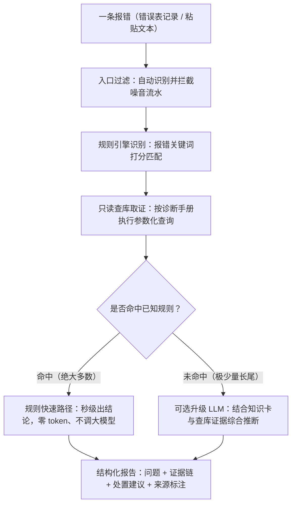

# 产品部对接材料：AIOps 产品介绍 · Dimple 系统对接 · 产品需求挖掘

---

# 一、AIOps 是什么？能解决什么问题？

## 1.1 一句话讲清楚

**AIOps 是一个"数据库报错自动诊断助手"：运维人员把一条报错喂给它，它几秒钟内回答三件事——这个报错是什么意思、为什么会发生、具体该怎么处理，而且每一步都附上可以自己复核的证据。**

打个比方：过去报错像病人拿着一张看不懂的化验单，得靠资深医生（老运维/DBA）凭经验判断；现在相当于给每个一线运维配了一个随身的"诊断专家"，常见病症它直接看，疑难杂症它会标明"把握不大、建议人工复核"并给出排查方向。

> 专业表述：AIOps 是面向 **GaussDB 信创环境**的数据库业务报错**根因诊断系统**，以确定性规则引擎为内核（20 类诊断手册 + 只读查库取证），并保留大模型（LLM）作为长尾报错的可选兜底，输出"问题定位 + 处置建议 + 可复核证据链"的结构化诊断报告。

## 1.2 核心能力：输入一条报错，输出三样东西

**输入**：一条报错，可以是数据库错误/报警表中的记录，也可以直接粘贴一段报错文本。

**输出**：

1. **问题是什么**：报错类型、根因结论、置信度；
2. **怎么解决**：分步骤的处置建议，具体到查哪些表、做哪些核对、哪些操作允许/禁止；
3. **可复核的证据链**：系统查了哪些只读 SQL、返回了什么、参考了哪条知识卡，逐条标注来源。

**三类证据（三证合一）**：

| 证据 | 来源 | 回答的问题 |
|---|---|---|
| 现场查库（事实，最终准绳） | 规则引擎执行只读 SQL | 现在数据库里实际是什么状态 |
| 领域知识（机制手册） | Dimple 知识库诊断卡 | 这类问题有哪些根因分支、处置边界 |
| 大模型综合（仅兜底） | 显式升级时才调用 LLM | 长尾、未覆盖报错的推断与排查方向 |

## 1.3 工作流程

两个关键设计：

- **默认纯规则、零 token**：高频报错走规则快速路径，不调用大模型，毫秒级返回、不产生任何模型调用成本；
- **诚实兜底、不臆测**：只有调用方显式要求升级（`escalate=true`）且部署允许时，未识别类型才走大模型；证据不足时如实给出低置信度并提示人工复核，绝不编造结论。

## 1.4 产品形态与当前进展

**目标形态**：私有化部署在内网的 **Web 诊断工作台**（正式前端 Vue3）+ **诊断 API**（FastAPI）+ **站内事件中心**（定时增量扫描，主动发现新报错/频率激增/未覆盖类型）。

需要特别说明的"实时监控"口径：做"类实时"的主动发现——后台每隔若干分钟增量扫描错误日志，把新类型、激增、未覆盖的报错聚合成站内事件，做到"报错发生后，带着答案等人来看"；后期也支持现有监控平台通过 webhook 把告警推给诊断 API，自动返回结论。

| 模块 | 状态 |
|---|---|
| 诊断内核（规则引擎 + 20 类诊断手册 + 只读查库） | 已落地、稳定 |
| 命令行（CLI）诊断工具 | 已落地 |
| FastAPI 诊断服务（含单条/批量诊断、记录查询、规则清单、历史统计、人工标注等接口） | 已落地 |
| 容器化交付（Dockerfile / docker-compose） | 已落地 |
| Vue3 正式前端工作台 | 开发推进中 |
| 监控/告警平台对接、统一鉴权 | 待对接 |
| 私有化规模化交付 | 后续规划 |
---

# 二、本周与 Dimple 系统对接：需要对方提供的信息清单

## 2.1 对接背景与对接模式

在**测试环境**完成 AIOps 与 Dimple 监控系统的**实时告警接口对接**联调与试用验证。

**对接模式：接口级实时告警对接**——Dimple 监控/告警系统产生报错告警后，通过接口实时给到 AIOps，AIOps 自动完成诊断并返回结论，让运维在收到告警的同时就能看到原因和处置建议。

同一接口模式下有两种数据流向，先确认 Dimple 支持哪一种：

| 数据流向 | 方向 | 说明 | 关键前提 |
|---|---|---|---|
| 拉模式（我方主动调用） | AIOps → Dimple 接口 | 我方按 Dimple 提供的接口查询/订阅告警 | 对方提供地址、端口、接口路径、鉴权 |
| 推模式（webhook） | Dimple → AIOps 接收地址 | Dimple 主动把告警推到我方服务 | 对方提供消息格式与鉴权，我方提供接收地址 |

## 2.2 需要向 Dimple 侧索要的信息清单

### A. 接口基础信息

| 序号 | 信息项 | 具体内容/用途 | 是否必须 | 已提供 |
|---|---|---|---|---|
| A1 | 测试环境监控/告警服务地址（IP/域名） | 配置接口调用目标 | 必须 | ☐ |
| A2 | 端口 | 配置接口端口 | 必须 | ☐ |
| A3 | 协议 | HTTP / HTTPS | 必须 | ☐ |
| A4 | 接口路径清单 / 接口文档 | 各接口路径、请求方式、参数；最好提供 Swagger/OpenAPI 文档地址 | 必须 | ☐ |
| A5 | 服务名称与版本 | 确认对接的具体服务和版本 | 必须 | ☐ |
| A6 | 支持的数据流向 | 拉取查询 / webhook 推送 / 两者都支持 | 必须 | ☐ |

### B. 鉴权与网络安全

| 序号 | 信息项 | 具体内容/用途 | 是否必须 | 已提供 |
|---|---|---|---|---|
| B1 | 鉴权方式 | API Key / Token / OAuth / 签名等，确认如何认证 | 必须 | ☐ |
| B2 | 访问凭证 | 凭证获取方式、有效期、轮换规则（走安全渠道传递） | 必须 | ☐ |
| B3 | 我方出口 IP 白名单 | 是否需要把我方 IP 加入白名单及办理流程 | 必须 | ☐ |
| B4 | 网络策略/端口开通 | 需开通的端口、审批流程与预计时长 | 必须 | ☐ |
| B5 | VPN / 跳板机 | 如需专线访问，确认账号申请方式 | 视情况 | ☐ |
| B6 | 调用限制 | 调用频率上限/限流、超时时间 | 建议 | ☐ |

## 2.3 我方可以同步提供的信息

| 提供项 | 说明 |
|---|---|
| 我方出口 IP | 供对方配置白名单 |
| webhook 接收地址 | （推模式）提供我方告警接收地址，供 Dimple 配置推送 |
| 服务部署方式 | 本地运行 / Docker 容器化，镜像与配置可快速就绪 |
| 诊断 API 清单与文档 | 提供 Swagger/OpenAPI 在线文档（`/docs`），含请求和响应样例 |

我方现有诊断服务接口（FastAPI）：

| 接口 | 方法 | 用途 |
|---|---|---|
| `/healthz` | GET | 健康检查：库连接、规则加载情况 |
| `/v1/diagnose` | POST | 单条诊断（传文本或按主键取数） |
| `/v1/batch-diagnose` | POST | 批量诊断 / 整表回放 |
| `/v1/records` | GET | 按来源/日期查询错误记录 |
| `/v1/rules` | GET | 规则与诊断手册清单 |
| `/v1/diagnoses` | GET | 历史诊断分页查询（多条件筛选） |
| `/v1/diagnoses/stats` | GET | 诊断聚合统计 |
| `/v1/diagnoses/{id}` | GET | 单条历史诊断详情 |
| `/v1/diagnoses/{id}/annotation` | POST | 人工确认/纠错标注 |

## 2.4 本周联调测试计划

|事项 | 验收标准 |
|---|---|
| 收齐接口文档与凭证，开通网络，验证接口连通性 | 成功调用查询/健康接口，或 webhook 接收地址验证通过 |
| 单条告警对接，跑通"告警 → 诊断 → 结论" | 一条真实告警能正确触发诊断并返回结论 |
| 典型报错类型覆盖、字段映射与降级验证 | 高频类型结论正确，异常/降级提示清晰 |
| 高频/批量告警与结论回写| 批量告警稳定处理，结论能按要求回写 |
| 汇总问题清单与试用反馈 | 输出问题清单和下一步需求输入 |

---

# 三、下一步产品需求（PR）挖掘：想请产品老师指导

## 3.1 我们面临的情况

- 当前没有甲方科技人员与我们对接，缺少直接的需求来源和真实使用反馈；
- 我们希望系统地挖掘下一步产品需求、摸清当前能力还有哪些欠缺，但在没有甲方对接人的情况下，需求挖掘具体该怎么开展，我们还没有成熟思路。

## 3.2 请求

1. 需求挖掘应该找谁？（比如公司内部测试/运维人员，或其他更合适的渠道）
2. 用什么形式收集需求和反馈？
3. 收集到的零散想法怎么收敛成可排期的 PR？
4. 产品侧和我们在这件事上怎么分工配合？

> 我们会配合老师确定的方式落地执行。

---

# 四、本次对接希望确认的行动项

| 序号 | 行动项 | 责任方 | 状态 |
|---|---|---|---|
| 1 | 确认接口对接数据流向（拉模式 / 推模式） | 双方 | ☐ |
| 2 | 提供监控/告警接口文档、地址端口与服务信息（A 类清单） | Dimple 侧 | ☐ |
| 3 | 提供鉴权凭证，完成网络白名单与访问策略开通（B 类清单） | Dimple 侧 | ☐ |
| 4 | 确认告警数据字段、测试样本与脱敏要求（C 类清单） | Dimple 侧 | ☐ |
| 5 | （推模式）确认诊断结论回写接口与格式 | Dimple 侧 | ☐ |
| 6 | 请产品老师明确 PR 需求挖掘的开展方式与分工 | 产品部 | ☐ |
| 7 | 明确双方对接人和日常沟通渠道 | 双方 | ☐ |

数据来源（字段、含义） 风控模块（历史报表 错单 预警 剩多少 跟踪 公式） 
java  交易部分（后台日志） 