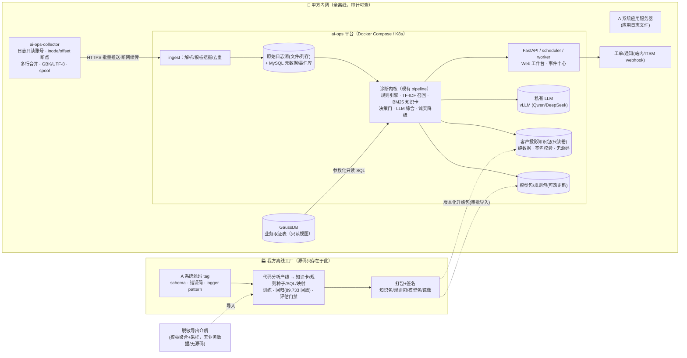

# 工程改造与未来完整方案——面向真实数据源与私有化交付的演进设计

> 配套文档：[现代商业化AI运维系统运作全景.md](./现代商业化AI运维系统运作全景.md)（以下简称《全景报告》）。
> 本文只回答一个问题：**在我们的真实约束下，当前工程要改成什么样、分几步走、交付形态如何成立。**
> 现状描述基于对仓库 `ai_ops 0.1.0`（src 单包布局，PR #2 后）的代码摸底；行业判断与数据均引自《全景报告》。
>
> 编写日期：2026-10-26　适用版本：ai_ops 0.1.0 主干

---

## 0. 结论速览（TL;DR）

1. **Oracle 必须整体退出运行时**。当前系统唯一的在线数据源是 Oracle（`ULOG.TLOG` 库表日志 + 5 张清算业务取证表），而目标环境里它不存在。工程要拆出两条新数据通道：
   - **报错内容** → 新建**服务器日志文件采集链路**（当前代码为零，需新建采集器；现有 `parser.py` 的正则资产可复用）；
   - **报错以外的业务事实**（持仓、价格、费率、交易日历等）→ 新建 **GaussDB 只读取证通道**（走 PostgreSQL 协议，规则 SQL 需要方言迁移）。
2. **源代码问题用"构建期/运行期分离"一次性解决**。A 系统是我们开发的，我们在自己的离线工厂里合法分析它；但**交付后在甲方环境运行的运维系统不读取、不挂载、也无权访问任何应用源代码**。源代码只在我方构建期被消化成三类不含源码的制品：**知识包、规则包、模型包**。现有的"知识快照不含源码（`contains_source_code=false`）"做法要从临时约定升级为强制工程纪律和合同条款。
3. **交付形态要产品化**：当前是"本地 CLI + Streamlit POC、无 Dockerfile、无服务"。要在 P2 前补齐 API/调度/Worker/Web、Docker Compose 离线镜像、客户专包投影、私有 LLM（vLLM）、升级与回滚、合规自检——这些在配置层（`paths.py` 的 `/app` 约定、`api` extras、`.dockerignore`、环境变量注入）已预埋，但实现代码为零。
4. **智能路线不变，而且被行业证据证明是对的**：保持"确定性编排决策门 + 经典 ML + 知识检索 + 单轮 LLM 综合"的混合架构（《全景报告》§5–§6：2025–2026 的行业共识是"确定性因果 AI + 预测 AI + 生成式/Agentic AI 三层叠加"，不是 LLM 取代一切）。一期**不做自动写操作/自动修复**（《全景报告》§12：过度授权 Excessive Agency 是首要风险，Gartner 预测规模化运行 agentic AI 的组织到 2028 年约 40% 会遭遇自动化引发的业务级中断）。
5. **数据飞轮必须跨交付边界设计**：甲方侧运行 → 脱敏/聚合导出 → 我方离线重训与知识更新 → 签名升级包 → 甲方导入。建立 **A 系统版本 ↔ 知识包版本 ↔ 模型/规则版本** 的三元绑定。
6. 节奏：**P0 去 Oracle + 日志接入（交付硬门槛）→ P1 GaussDB 取证 → P2 服务化与私有化交付 → P3 知识产线内化与合规自检 → P4 检测/事件中心/LLM 调查升级**。

---

## 1. 现状与差距

### 1.1 当前工程真实形态（摸底事实）

| 维度 | 现状 | 关键位置 |
|---|---|---|
| 形态 | 本地 `uv sync` 运行的 **CLI 内核** + Streamlit POC；无 API/服务、无 Dockerfile、无建库脚本 | `src/ai_ops/cli.py`、`demo/app.py` |
| 数据源 | **仅 Oracle**：`oracledb` thin 模式只读连接；"日志"是库表 `ULOG.TLOG`（ID/LDATE/LLEVEL/ERRCODE/LSECTION/LTEXTE/FUNC_NO），另有 5 张业务取证表（`CLEAR.TC_FTR_CLIENT_POSI_CLEAR`、`TC_CLEAR_POSI_DETAIL`、`TC_CLEAR_PRICE`、`TC_DEFER_FEE_RATE`、`INTERFACE.TP_EXCH_TRADE_DATE`） | `engine/db.py`、`engine/tlog.py`、`ml/dataset.py`、3 个 runbook YAML |
| 日志文件采集 | **不存在**。无 tail/watch/轮转/多行合并任何代码；`--text` 只接受人工粘贴 | — |
| GaussDB/PG/MySQL | 运行时代码为零；`pymysql` 仅在未落地的 `api` extras 里；文档规划 MySQL 8 做元数据 | `pyproject.toml` |
| 诊断链路 | 混合决策门：规则命中+高置信走零 token 快路径，否则三证合一（历史案例 TF‑IDF 召回 + 现场只读 SQL + Dimple 知识卡 BM25）交单轮 LLM，失败逐级兜底 | `pipeline.py`、`rule_engine.py`、`ml/router.py`、`ml/retriever.py`、`kb/client.py`、`llm/` |
| 知识库 | 外部工程 `dimple-knowledge-base` 的**离线快照**；通过 importlib 动态加载其 `kb.py`；纯本地 BM25，无向量/嵌入；知识卡是"冻结源码分析"的产物，卡片回指 repository/path/symbol/revision，**快照本身不含源码**；有 audience 投影门禁（internal/common/客户ID） | `kb/client.py:23-28,107-122`；《知识库集成说明》 |
| 源代码依赖 | **运行时不读源码**，无静态分析/AST/tree-sitter；对 `LSECTION` 的包名/存储过程/行号只做字符串正则 | `engine/parser.py:18` |
| LLM | OpenAI 兼容单轮调用（urllib 直连，无 Agent/function calling/MCP），开发期 qwen 网关，交付目标内网 vLLM/Ollama | `llm/client.py` |
| 规则 | 包内基线 + `AIOPS_RULES_DIR` 外挂双层合并（支持免重打包热更新） | `rules_store.py`、`assets/rules/` |
| 安全 | 三重只读（只读账号 + 写 SQL 正则拦截 + 参数化白名单 SQL）；知识卡只读 SQL 默认不执行；LLM 不触达数据库 | `engine/db.py:13-27`、`kb/client.py` |
| 资产与评估 | 路由模型两个（约 1.7MB，准确率 99.98%/99.72%）；89,733 条历史数据回放基线（快路径 94.03%、3 规则时 LLM 率 5.64%→Top30 规则 0.40%） | `scripts/hybrid_replay.py`、`ml/train_router.py` |
| 打包 | wheel 只含代码与规则 YAML；不含配置真值、模型、数据集、知识包、demo、docs | ADR 0001 |
| 已知风险 | demo 样例与批量报告含**真实客户号/IP**；importlib 加载外部 `kb.py` 是路径耦合 + 任意代码执行面 | `demo/samples/`、`kb/client.py` |

### 1.2 与现代商业 AIOps 标准架构的差距

对照《全景报告》§3–§7 的标准流水线（采集 → 管道 → 存储 → 语义/拓扑 → 检测关联 → RCA/预测 → LLM/Agent → 服务化与交付）：

| 层 | 行业标准 | 本工程 | 差距判定 |
|---|---|---|---|
| 采集 | OpenTelemetry/OTLP、eBPF 无侵入、日志文件 receiver | 只有 Oracle 表查询；无文件/指标/链路采集 | **致命缺口（P0）** |
| 管道 | Collector Gateway + Kafka/Flink、尾部采样 | 无 | 暂不需要（单系统、清算批处理量级），预留 schema 即可（P3+） |
| 存储 | 列存 OLAP / 湖仓 / 时序降采样 | 无（CSV 文件 + joblib） | P2 需要"原始日志湖"（文件或 ClickHouse 类），元数据 MySQL |
| 语义层 | 实体模型、服务依赖拓扑、变更关联 | 仅有知识卡内的静态调用信息 | P3–P4：从知识包+日志调用链构建实体/拓扑 |
| 检测/关联 | 动态异常检测、告警关联降噪、日志模板挖掘（Drain） | 骨架正则 + TF‑IDF + 规则 | 骨架归一本质是手工模板，P1 引入（半）自动模板挖掘；告警关联 P4 |
| RCA | 拓扑因果 + 变更关联 + AI 调查 agent | 只读 SQL 取证 + 规则裁决 + LLM 综合 | 路线正确（现场查库而非文本分类，与行业一致），扩展证据源即可 |
| LLM/Agent | NL2Query、RAG、多 agent 调查、分级授权修复 | 单轮三证合一 | P4 做"只读调查 agent"；写操作不做 |
| 服务化 | Web/API、事件中心、on-call、ITSM 集成 | CLI + Streamlit POC | **P2 必做**（交付的最低形态） |
| 交付 | 离线镜像、单租户/on-prem、私有 LLM、升级回滚、审计 | 文档有目标态，代码为零 | **P2 必做** |

### 1.3 必须保留的资产（这些恰好踩在行业正确路线上）

- **确定性决策门 + 高置信快路径**：《全景报告》§6/§12 的核心治理建议就是"用确定性策略门约束生成式 AI"；94% 快路径还意味着极低的 LLM 推理成本（私有化 GPU 资源下这是生死线）。
- **三证合一的证据分级**（历史先验 / 现场事实 / 机制手册），且强制 LLM 不得把冻结知识当现场事实——这正是业界 RAG 事故的主要教训。
- **三重只读、知识 SQL 默认不执行**：与《全景报告》§8"调查可自主、写入需授权""给智能体发工牌而不是 root"完全一致，迁移到 GaussDB 时原样保留。
- **规则双层热更新、模型可重训、知识包 audience 投影**：是跨交付边界运营（数据飞轮）的现成钩子。
- **诚实降级与断库替身**（`_NoSQLEngine`、KB/LLM 异常静默降级）：私有化现场没有公网、服务常缺省，这种"任何一块缺失仍给出可用结论"的设计要产品化进所有数据源。

---

## 2. 五个现实约束的工程含义（核心章节）

### 2.1 约束总览

| # | 约束 | 工程动作 | 阶段 |
|---|---|---|---|
| 1 | Oracle 没有意义/不存在 | 移除 `oracledb` 与全部 Oracle SQL；数据源解耦为统一 `RecordSource` / `EvidenceSource` 接口 | P0–P1 |
| 2 | 有 GaussDB，**但无报错日志数据**，有报错以外的相关数据 | GaussDB 仅承接**业务取证**（只读）；PG 协议驱动 + 方言适配；runbook SQL 全量迁移 | P1 |
| 3 | 服务器日志文件里有报错内容 | 新建文件采集器（轮转/断点/多行/编码）；解析归一到标准记录 schema；报错诊断主输入切换 | P0 |
| 4 | 我们有 A 系统源代码 | 建设我方**离线代码分析产线**，产出知识包/规则种子/SQL 验证；代码永不出我方内网 | P3（先用现有 Dimple 流程兜底） |
| 5 | 交付后甲方环境**运维系统不得读取源代码**（合规） | 构建期/运行期物理分离；交付制品清单全部 `contains_source_code=false` 并可自证；知识包数据化（去掉 importlib 执行外部代码）；版本三元绑定 | P0 立规矩，P2–P3 落地 |

### 2.2 约束 1+2：去 Oracle，GaussDB 只做业务取证

**职责切分（重要）：**GaussDB 不承接报错日志，意味着它在本系统里的角色是**证据库（EvidenceStore）而非事件源**——对应现有 runbook 里 5 张业务表的用途，而**不**对应 `ULOG.TLOG` 的用途。不要试图在 GaussDB 里重建一张 TLOG 表来"最小改动"，那会把合规边界（甲方是否允许写库、日志留存口径）搞混。

工程改动：

1. **数据源抽象**（现在 `engine/db.py` 是 Oracle 直连，全系统被它绑死）：
   - 新增 `sources/base.py`：`RecordSource`（报错记录流，供诊断/训练）与 `EvidenceSource`（参数化只读查询，供规则取证）两个协议；
   - `pipeline.diagnose()` 的 `eng=` 依赖注入已经是正确形状，扩展为多源注入即可，编排层不动。
2. **GaussDB 驱动与连接**：GaussDB/openGauss 兼容 PostgreSQL 协议，优先 `psycopg`（v3）纯 Python 实现，POC 第一步验证目标库版本与协议兼容模式、字符集、SSL；连接配置进 `config/sources.yaml` + `AIOPS_GAUSS_*` 环境变量，沿用现有 config 模式。
3. **只读网关平移**：`db.py` 的写拦截正则、`:bind` 参数化、`SELECT 1` 连通自检原样保留，改成 PG 驱动实现；GaussDB 侧仍使用**只读账号**（库级授权由甲方 DBA 配置，只授予 5 张取证表（或其视图）的 SELECT）。
4. **runbook SQL 方言迁移**（逐表核对，建立《方言迁移表》）：
   - `DUAL` → 去掉或 `SELECT 1`；`NVL` → `COALESCE`；`TO_DATE/TO_CHAR` 格式串；`ROWNUM` → `FETCH FIRST n ROWS ONLY` / `ROW_NUMBER()`；`SYSDATE` → `CURRENT_TIMESTAMP`；`||` 拼接、隐式类型转换、`DECODE` → `CASE`；
   - 标识符大小写规则（PG 系折叠为小写）、schema 名称（`CLEAR.`/`INTERFACE.` 在甲方 GaussDB 里是否同名，必须配置化，不写死）；
   - 每个 runbook 迁移后必须用 `scripts/verify_samples.py` 在甲方脱敏库回放通过才允许发布——该脚本已有，扩展为多数据源。
5. **删除清单**：`oracledb` 依赖、`engine/tlog.py` 的 TLOG 直查、`ml/dataset.py` 的 TLOG 训练集抽取、doctor 的 Oracle 连通检查（替换为 GaussDB + 采集器双检查）。
6. **历史训练数据**：现有 89,733 条 TLOG 导出（CSV）按《训练数据标准化规范》继续作为离线训练资产，与运行时是否有 Oracle 无关——训练在我方工厂完成，模型以 joblib 制品交付。

### 2.3 约束 3：服务器日志文件采集链路（从零新建，P0）

这是本次改造唯一真正的"硬新工程"。目标：**让日志文件经过采集解析后，产出与现在 `ULOG.TLOG` 行同构的标准记录**，使下游 parser/ML/规则/KB/LLM 管线零改动。

**标准记录 schema（建议定为内部 v1 契约）：**

```json
{
  "id": "稳定去重ID(主机+文件+inode+offset 或内容指纹)",
  "ts": "2026-10-26T08:00:01+08:00",
  "level": "FATAL|ERROR|WARN|INFO",
  "errcode": "ORA-/业务码/空",
  "section": "PKC_XXX.SP_YYY:123  （调用栈/logger 名，从原 LSECTION 语义迁移）",
  "text": "报错原文（归一化前）",
  "func_no": "若日志中存在",
  "host": "app-01", "source_path": "/.../xxx.log", "raw": "原始行(可选留存)"
}
```

**采集器设计（P0 自研轻量版，单系统几台至十几台应用服务器的清算场景，不需要上 Kafka）：**

| 能力 | 设计要点 |
|---|---|
| 发现 | 配置日志目录/glob 模式；支持多台主机：一期每台应用服务器部署一个 collector 进程（或 sidecar），HTTP 批量推送到中心 ingest；推不上时本地 spool 缓存，断网续传 |
| 轮转 | 同时处理 rename/create（logrotate）与 copytruncate；以 **inode + offset** 做断点，truncate 归零、rename 后跟随新 inode；防止重复与丢行（至少一次 + 下游按 id 去重） |
| 多行合并 | Java/存储过程堆栈跨多行：以时间戳/级别行首正则作为新记录边界，合并后续堆栈到 `raw`/`text` |
| 编码 | GBK/UTF-8 自动探测（Windows 服务器/老 Java 应用常见 GBK），不可解码字符替换不中断 |
| 解析 | 复用 `engine/parser.py`：noise/ora/biz/other 分类、骨架归一、`[字段=>值]` 参数抽取、`PKC_/SP_:行号` 调用栈提取；若新日志格式与 TLOG 文本不一致，在 parser 前加格式适配层（按 logger pattern 配置） |
| 水位与吞吐 | 批量拉取/推送、背压；大文件首次采集只扫尾部 N 天或全量可配；采集延迟自检进 doctor |
| 权限 | collector 只需日志目录读权限，不需要应用账号、不需要 sudo（部署文档明确这一条，降低甲方过审阻力） |

**技术选型取舍**：P0 自研轻量 tailer（逻辑集中在 inode/offset + 多行 + 推送，约一两个迭代），记录 schema 向 OpenTelemetry Log Record 语义靠拢；P3 之后如需多租户/多系统扩展，用 **OpenTelemetry Collector filelog receiver** 替换自研采集端（《全景报告》§4：OTel 2026 年已从 CNCF 毕业、是事实标准），中心解析不动。不引入 eBPF（Java 应用报错诊断的价值点在应用日志文本，eBPF 解决的是无侵入 RED 指标，不是本场景的主矛盾）。

**原始留存**：原始日志按天压缩落"日志湖"（一期文件系统/NAS 即可，量大后再评估 ClickHouse 类列存，《全景报告》§4）；模板聚合后的结构化记录进 MySQL（已规划）供检索与回放。注意存储成本纪律（§12 FinOps）：原文保留期、模板率（骨架聚合一族只存一条模板+计数+参数样本）分级。

**采集器与合规**：collector 是甲方环境里唯一需要新开口的组件，部署方案要过甲方安全评审（进程身份、外发方向只到内网中心、无公网、可审计）。

### 2.4 约束 4：源代码是我们的——建设"离线代码分析产线"

我们拥有 A 系统源代码是**合法的知识优势**，行业里对应的正是 Dynatrace/Datadog 用代码库/部署信息增强 RCA 的做法；关键是把这个优势**在我方构建期兑现成制品**，而不是带到甲方现场。

当前 Dimple 知识库工程事实上已承担"源码分析产线"角色（基线名 `SOURCE_ANALYSIS`，615 条知识卡、7 个本体切片、错误索引、诊断卡、日志模板、Mapper SQL），但它是**外部的、手工的、importlib 强耦合的**。要把它产品化：

1. **产线输入**：A 系统带版本号的源码 tag + 数据库 schema（表/字段/存储过程）+ 日志配置（logger pattern、错误码字典）。
2. **产线输出（全部不含源码原文）**：
   - **知识包**：诊断卡、分支条件、只读取证 SQL（参数化）、日志锚点模板、本体关系；sources 元数据保留 repository/path/symbol/revision 用于我方追溯，**客户投影时可裁剪这些路径字段**；
   - **规则种子**：`scripts/gen_rule_seed.py` 现在从 TLOG 蒸馏，扩展为"知识卡 readonly_queries → runbook"的批量派生（现有 K3 待办，Top30 骨架覆盖 93.5%）；
   - **解析资产**：错误码表、logger pattern、`FUNC_NO ↔ 存储过程`映射——直接喂给 P0 的日志格式适配层；
   - **模型训练集/评估集**：源码分析出的调用关系用于构造合成故障样本（《全景报告》§6 中 AIOpsLab 方法论：故障注入+工作负载生成做 agent 评测，我们在离线环境做轻量版）。
3. **产线工程化**：版本化流水线（CI job：源码 tag → 分析 → 知识包 → 规则/模型回归（89,733 回放集 + 准确率门禁）→ 签名制品），产出物带语义化版本与兼容性矩阵（见 §5.4）。
4. **客户版本分叉问题**：甲方持有的 A 系统版本可能落后于主线或被现场定制。产线必须支持**按客户版本 tag 出包**；现场升级 A 系统时，知识包/规则包作为升级配套件同步发版（合同里写明联动义务）。

### 2.5 约束 5（最关键）：交付后运维系统不得接触源代码的合规架构

**总原则：构建期知道代码，运行期只认证据包（Build-time knows code; runtime knows only evidence packs）。**

**（1）三类制品物理隔离**

| 制品域 | 内容 | 所在环境 | 源代码含量 |
|---|---|---|---|
| 我方内部资产 | A 系统源码、分析产线、内部知识全集（internal audience）、原始训练数据、实验 | 我方内网，**永不出域** | 有 |
| 交付制品 | ai_ops 运行时镜像、规则包、模型包、**客户投影知识包**、配置模板 | 甲方内网 | **零**（全部 `contains_source_code=false`，可机器校验） |
| 甲方数据 | 日志文件、GaussDB 业务库 | 甲方内网 | 不含我方源码 |

**（2）知识包数据化，去掉 importlib 执行外部代码**

现状 `kb/client.py` 动态加载 `kb_root/installation/skills/.../kb.py`——这在交付态有两个问题：路径强耦合（客户目录结构必须长一样）和**任意代码执行面**（甲方安全评审大概率不过）。改造：

- 知识包定义为**纯数据包**：清单 `manifest.yaml`（版本、适用系统版本、audience、哈希、`contains_source_code: false`、生成日期、签名）+ JSON/YAML 知识卡 + 预构建 BM25 索引（或倒排数据文件）；
- BM25 检索引擎**内置进 `ai_ops` 包**（把外部 kb.py 的检索逻辑以我方代码形式内化），运行时只读数据，不加载任何客户目录里的 Python；
- audience 投影（现有 `dimple_install --audience <客户ID>`）升级为产线的正式出包命令，internal 全集物理上不进入交付镜像；
- 加载时校验清单签名与哈希，不通过则拒绝加载并降级（沿用现有静默降级 + 显式黄条告警模式）。

**（3）运行时"无源码"可自证**（这是过甲方合规检查的关键交付物）

- `ops/doctor.py` 增加**合规自检项**：配置中不存在任何源码路径、进程对源码目录无挂载/无读权限（部署时以非root 用户运行，卷挂载清单只含日志目录/GaussDB 网络/知识包卷/模型卷）、知识包清单字段校验通过、镜像 SBOM（Python 依赖 + 许可证）随交付提供；
- 输出一份《部署合规自检报告》（机器可读 JSON + 盖章 PDF 可选），作为验收材料；
- 交付前 CI 跑**制品扫描门禁**：wheel/镜像/知识包内不出现 `.java/.py/.sql 存储过程源码/.git` 等模式（知识卡里的片段必须是模板/伪码级别，现有规范已经这样要求，加自动扫描兜底）；
- `demo/samples` 真实客户号/IP、`var/` 历史报告一律不进交付物（当前 gitignore/wheel 边界已排除大部分，补镜像级扫描）。

**（4）合同与知识产权配套**（工程外但必须提）

- 知识包授权条款：客户投影包授权给指定甲方/指定系统版本，不得逆向；知识卡中 sources 字段在客户版裁剪为内部代号；
- 数据回传条款：甲方允许以"模板聚合+采样+脱敏"形式导出错误数据用于模型改进（见 §6），明确不含业务数据；
- 验收材料清单写入合同：合规自检报告、SBOM、数据流向图、端口与账号清单（只读账号、日志只读账号各一个）。

**（5）私有化运行环境全部假设断网**：私有 LLM（vLLM/Ollama，OpenAI 兼容协议，现有 `llm/client.py` 零改动换 base_url）、无公网 token、时间/NTP、离线 license 与升级包均通过介质/内网制品库流转。

---

## 3. 目标架构（交付态）



**端到端数据流（一次报错的旅程）**：应用日志落盘 → collector 断点读取、多行合并、推送 → ingest 解析为标准记录（复用 parser 资产）→ 模板/骨架归一与去重 → 触发诊断内核：ML 分流（类型/业务类型）→ 历史案例召回 → 规则引擎带参数查 **GaussDB 只读视图**取证 → 知识卡给机制与分支（纯数据包检索）→ 决策门：高置信出结论，否则三证合一进私有 LLM → 结论/证据/报告落 MySQL 与事件中心，必要时建工单；全流程只读，无任何写操作、无任何源码读取。

---

## 4. 工程改造清单（落到模块）

### 4.1 包结构调整建议

```
src/ai_ops/
  sources/                  # 新增：数据源层
    base.py                 # RecordSource / EvidenceSource 协议
    logfiles/               # P0
      collector.py          # 发现/轮转/inode-offset/多行/编码/spool
      pusher.py             # 批量推送+重试
      patterns.yaml         # 各 A 系统版本的 logger pattern
    gauss/                  # P1
    db.py                   # psycopg 只读网关（平移 db.py 三重只读）
    evidence.py             # 参数化只读查询（供 rule_engine 调用）
    oracle/                 # 删除（保留一个 git 历史可溯的迁移说明即可）
  ingest/                   # P0：服务端接收+解析+模板+去重
    server.py  normalizer.py  templates.py（Drain 式模板挖掘的演进位）
  engine/ parser.py（保留扩展） rule_engine.py（方言无关化）
  ml/        dataset.py 改读日志湖/导出CSV（去 TLOG SQL）
  kb/        client.py（去 importlib，改读纯数据包+签名清单）
  llm/       不动
  service/   # P2：api.py / scheduler.py / worker.py（落地 api extras）
  ops/       doctor.py 增加 GaussDB、采集水位、合规自检三类检查
  assets/    rules/（基线）；新增 manifests 模板
deploy/      # P2：Dockerfile、compose、MySQL init、离线镜像清单、部署手册
packaging/   # P3：知识包/模型包打包签名工具（内化 dimple_install）
```

### 4.2 配置与打包

- 新增 `config/sources.yaml.example`：日志源（主机/路径/pattern/编码/首次扫描范围）、GaussDB（dsn/账号环境变量/schema 映射/允许查询表白名单）；
- wheel 边界维持 ADR 0001（代码+规则）；知识包、模型包、镜像成为**独立版本化制品**，规则热更新机制（`AIOPS_RULES_DIR`）扩展为 `AIOPS_KB_DIR`、`AIOPS_MODELS_DIR` 同级的挂载式热更新；
- 镜像以非 root 运行；卷只有四个：日志目录（只读挂载）、知识包（只读）、模型/规则（只读）、数据输出（读写）。

### 4.3 可观测性与自评估（运维运维系统自己）

collector 延迟、采集行数、解析失败率、GaussDB 查询耗时/失败率、LLM 调用率/失败率、降级触发次数全部进 doctor 与内部看板——私有化现场"出问题说不清"是交付项目最大的运维成本。

---

## 5. 分期路线图

| 阶段 | 目标 | 主要工作 | 验收标准（硬） |
|---|---|---|---|
| **P0 去 Oracle + 日志接入**（交付硬门槛） | 报错主输入从 TLOG 表切到日志文件，系统脱离 Oracle 能跑 | 数据源抽象；collector（轮转/断点/多行/编码/推送）；ingest 与标准记录 schema；parser 格式适配；dataset 改读日志湖；demo/doctor 改双源 | 在无 Oracle 环境用真实/仿真日志端到端跑通 3 类已覆盖报错；回放集（89,733 条经文件通道重放）路由准确率不劣化（≥99.9% 基线的 1 个百分点内）；断网/轮转/truncate 场景零丢失零重复（去重后） |
| **P1 GaussDB 取证** | 业务事实证据源上线 | psycopg 网关、只读账号/白名单、schema 配置化、3 个 runbook 方言迁移、verify_samples 双源 | 3 个 runbook 在甲方脱敏库全部回放通过；写拦截/参数化测试保留；doctor 双源通过 |
| **P2 服务化与私有化交付** | 从 POC 变成可交付产品 | FastAPI + scheduler（增量扫描/站内事件）+ worker + MySQL + Web 工作台；Dockerfile/compose/离线镜像；私有 vLLM 接入回归；升级/回滚；合规自检 v1 | 全新内网环境按手册 1 天内完成离线部署；断网全程可用；规则/知识/模型挂载热更新生效；镜像通过"零源码"扫描 |
| **P3 知识产线内化 + 合规体系** | 源码知识优势可持续、可过审 | 知识包数据化（去 importlib）、产线 CI（源码 tag→包→回归→签名）、客户投影出包、SBOM、合规自检报告、版本三元绑定 | 知识包加载不再执行任何外部 Python；客户包通过制品源码扫描；按两个不同 A 系统版本各出一包且现场识别版本不匹配并拒绝启动 |
| **P4 检测/事件中心/LLM 调查升级** | 从 L1（智能告警辅助）走向 L2（自动化根因） | 日志模板自动挖掘（Drain 式）、模板激增/新型事件检测、事件聚合、（只读）调查 agent（跨日志/知识/历史取证串联、事故总结草稿）、ITSM webhook | 新增模板自动发现率/误报率达标并经影子模式（shadow mode，只建议不生效）≥2 周；Top30 骨架规则覆盖率≥90%；agent 仅读不写，全部动作有审计 |

排序理由：《全景报告》§10/§11 的证据——Gartner 2026 年 I&O 调研里仅 28% 的运维 AI 用例完全达成 ROI、20% 失败，**数据质量差（38%）是首因**；行业反复验证的顺序是"先治数据、治告警，再上 AI/自治"。P0–P1 是数据底座，P2 是交付资格，P3 是合规护城河，P4 才是更多 AI。

---

## 6. 跨交付边界的数据飞轮

```
甲方现场：模板聚合后的骨架分布、新型错误样本（脱敏采样）、
          人工关闭原因/纠错标注、规则命中与 LLM 成败日志
   │  （导出格式沿用《训练数据标准化规范》：标准 CSV；不含客户号/账号/价格等业务值，
   │    错误原文按模板参数脱敏；导出动作有审计，介质/内网制品库交付）
   ▼
我方工厂：数据集合并 → 规则种子蒸馏 → 知识卡更新 → 模型重训
   │  → 89,733 回放集 + 新样本做回归门禁（准确率/覆盖率/LLM 调用率只许变好）
   ▼
签名升级包：规则包 / 知识包（客户投影）/ 模型包（语义化版本 + 兼容性矩阵）
   ▼
甲方导入：先影子模式比对 → 灰度 → 正式；支持一键回滚
```

**版本三元绑定（兼容性矩阵）**：`A 系统版本 ↔ 知识包版本 ↔ 模型/规则包版本`。启动时校验，不匹配拒绝运行（宁可不可用，不可错诊断），doctor 报告当前三元组。

---

## 7. 风险与工程纪律（对照《全景报告》§12）

1. **不做自动修复/写操作**（至少到 P4 之后再评估分级放开）。行业教训：过度授权是 agentic AI 首要事故源（PocketOS 类事故：无限权 token + 无审批，9 秒删除生产卷及备份）；Gartner 预测规模化 agentic AI 组织到 2028 年约 40% 遭遇自动化引发的业务级中断。我们的 LLM 永远拿不到数据库写权限和 shell——现有三重只读到 GaussDB 原样保留。
2. **幻觉控制**：延续"LLM 只综合证据、不产出未经验证的事实"；知识卡强制标注"冻结分析、非现场事实"；《全景报告》§6 中 ORCA-bench 显示最强模型真实 on-call RCA 准确率也仅 Medium 25.3%/Hard 10.0%、最弱模型 40% 报告含幻觉根因——因此**结论置信度与证据清单必须外露**，低置信转人工，不粉饰。
3. **数据质量先行**：采集解析失败率、模板归一质量是 P0/P1 的头号指标，宁可少诊断不可错分类（路由 99.98% 的信任来自训练集质量，换数据通道后必须重新验证）。
4. **不追 agent 炒作**：Gartner 预测 2027 年底前超 40% agentic AI 项目将被取消（成本/价值不清/风控不足）。我们的卖点是"清算业务报错的高准确诊断覆盖率"，不是"全能运维 agent"。
5. **私有 LLM 成本与回归**：94% 快路径是私有化 GPU 经济性的核心，保持；换模型（qwen/DeepSeek 新版本）必须过完整回放集与人工标注集双回归。
6. **可观测性 FinOps**：日志原文分级留存、模板聚合降基数；collector 默认只采错误相关/配置的目录，不做全量地毯式采集。
7. **交付卫生**：真实客户数据（demo/samples、历史报告）、内部地址、内部知识全集零出境，CI 扫描门禁兜底。
8. **评估方法**：所有新智能能力先影子模式（只记录建议不生效）≥2 周，用 precision/recall、告警负担、人工采纳率说话，再谈生效。

---

## 8. 需要甲方/商务侧确认的问题（开工前清单）

1. GaussDB 具体版本/兼容协议（openGauss 系还是分布式 GaussDB）、字符集、PG 驱动连通性；5 张取证表在甲方侧的库/schema/视图命名与授权方式；
2. A 系统应用服务器清单、操作系统、日志目录/文件名 pattern、轮转方式（logrotate? 应用自切? copytruncate?）、编码、时区；日志里是否保留与 TLOG 同构的字段（LSECTION/FUNC_NO/ERRCODE）；
3. collector 部署权限：能否以普通服务账号读取日志目录？中心服务部署位置与网络策略（只开内网端口）；
4. 私有 LLM 资源：有无 GPU、可提供的模型规格、并发与延迟；
5. 合规：等保级别要求、数据出域方式（物理介质/专线制品库）、知识包知识产权与逆向限制条款、验收所需报告清单；
6. A 系统的客户版本基线与后续升级节奏（决定知识包跟版策略）；
7. MySQL/元数据库由我方提供镜像还是使用甲方现有数据库服务；时间同步（NTP）源。

---

## 9. 成功指标（延续现有量化基线）

| 指标 | 现状基线 | P0–P2 目标 | P4 目标 |
|---|---|---|---|
| 路由/分流准确率 | 99.98%（一级）、99.72%（业务类型） | 换数据通道后不劣化 >1pct | 新模板纳入后持续 ≥99% |
| Top 骨架规则覆盖率 | Top30 覆盖 93.5%，3 规则时 LLM 率 5.64%→0.40% | 覆盖率不下滑 | 规则+知识覆盖 Top30 ≥90%，新型模板 2 周内入库 |
| 诊断时效 | 人工检索为主 | 报错入系统到出诊断 ≤5 分钟（采集+诊断） | 站内事件自动聚合，常见事件 MTTR 下降（以影子期人工对照测算，引用时标注自测口径） |
| 采集可靠性 | — | 轮转/truncate/断网场景零丢失、去重后零重复 | — |
| 自动化安全 | 三重只读、LLM 零写权限 | 保持 | agent 仍 100% 只读，审计覆盖率 100% |
| 交付合规 | 知识包不含源码（约定） | 机器可校验、可出自检报告 | 按客户版本出包，版本不匹配拒绝启动 |

> 报告中引用的行业收益数字（Forrester TEI、各厂商 MTTR 改善等，见《全景报告》§11）多为厂商委托或自述口径，**本项目对外只承诺自测口径**，并在 POC 阶段用同一批历史事故做"有/无系统"对照测算。

---

## 附：与《全景报告》章节的对应关系

- 数据通道与标准记录 schema ↔ §3 总体架构、§4 数据层（OTel/日志信号、存储路线）
- parser/模板挖掘、规则取证 ↔ §5 经典 ML 引擎（日志聚类/Drain）
- 决策门保留、LLM 调查升级边界 ↔ §6 LLM 与 Agent、§8 人机协同
- 事件六阶段与 P4 事件中心 ↔ §7 事件全生命周期
- 私有化/定价无关但交付形态参考 ↔ §9 部署与商业模式
- P0–P4 排序 ↔ §10 成熟度与落地路线（先数据后 AI）
- 指标口径 ↔ §11 ROI 实证
- 只读、不自动修复、影子模式、FinOps ↔ §12 风险与治理
