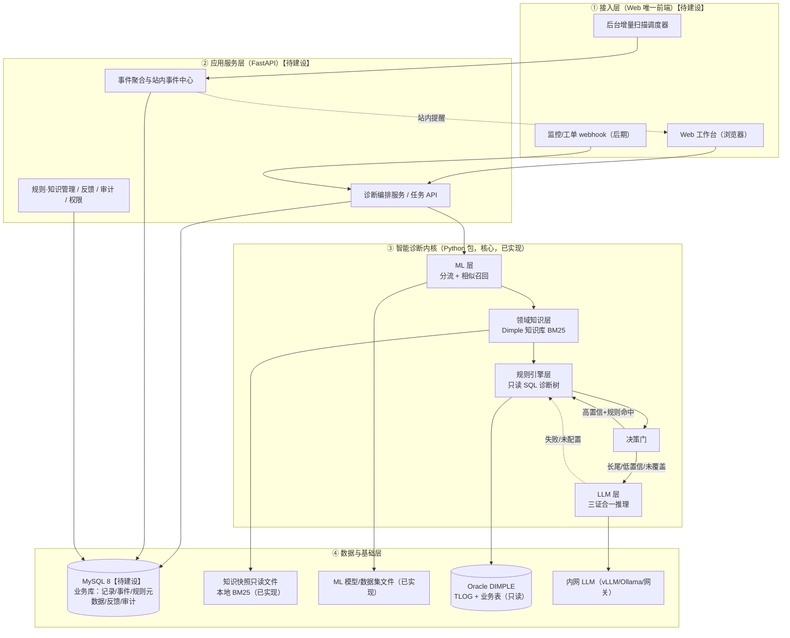
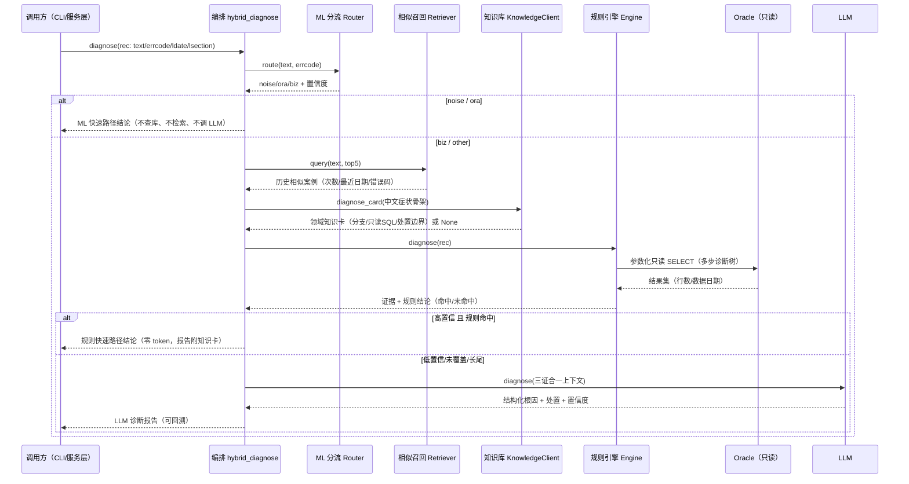
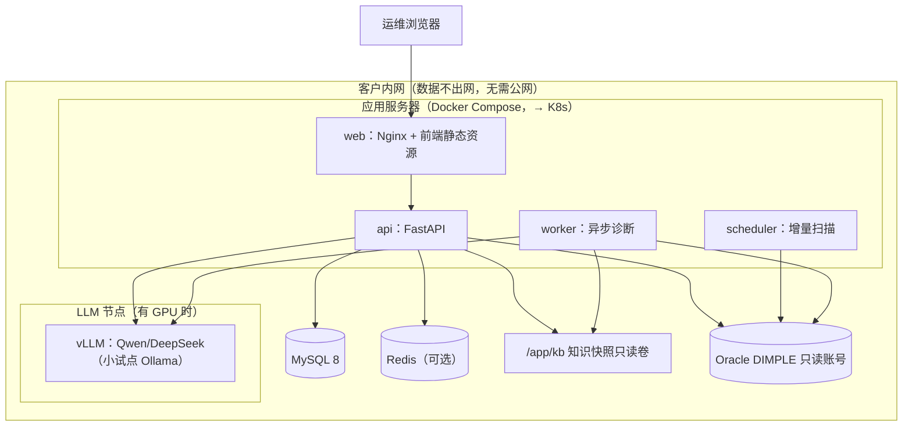

# 数据库业务报错智能诊断系统 · 整体技术架构设计文档

> 项目：DIMPLE 期货/黄金清算系统（Oracle `10.253.162.172:1521/dmpdb`）业务报错智能诊断
> 文档版本：v1.0　|　日期：2026-10-21　|　状态：架构评审稿
> 状态标记约定：**【已实现】** = 已在代码中跑通（当前 CLI 内核）；**【待建设】** = 产品化阶段开发。

---

## 一、架构目标与范围

### 1.1 业务目标

针对 DIMPLE 数据库层**已知报错**，自动回答两件事：**"问题是什么"** 和 **"怎么解决"**，并给出**可复核的证据链**。不做实时指标监控，不做应用层问题诊断。

### 1.2 系统范围

- **只做**：TLOG 中数据库业务报错（biz 类）的根因诊断与处置建议；噪音/ORA 类只做分诊不深入。
- **不做**：实时监控大屏（夜莺/Prometheus 已成熟）；应用层异常；任何对生产库的写操作。
- **对象**：仅 Oracle DIMPLE 的 TLOG 与业务表，**全程只读**。

### 1.3 设计约束

| 约束 | 说明 |
|---|---|
| 内网私有化 | 全系统部署在客户内网，数据不出网；LLM 用内网私有化模型，无公网 token |
| 全程只读 | 对生产库只允许 SELECT；代码层写拦截 + 只读账号 + 规则 SQL 白名单三重约束 |
| 可降级 | LLM 不可用→规则+知识库；知识库不可用→规则+ML；任一增强组件缺失都不阻断主流程 |
| 可审计 | 报告逐步标注由 ML / 知识库 / 规则 / LLM 完成；查库、规则发布、配置变更有审计 |
| 客户隔离 | 知识按客户投影，内部全集不外发；密钥/数据/模型不入库 |

### 1.4 设计原则

1. **确定性与智能分层**：能用确定性手段（ML/规则/检索）前置解决的，不调用 LLM；LLM 只处理真正需要推理的长尾。
2. **三证合一**：LLM 的结论必须同时建立在"历史案例（先验）+ 领域知识（机制）+ 现场查库（事实）"之上，且以现场事实为准。
3. **零 token 优先**：高频问题走 ML + 规则快速路径，LLM 调用率压到 0.4% 量级。
4. **可插拔**：ML、知识库、LLM 均为可独立关闭/降级的模块，核心诊断不被任一组件锁死。
5. **内核与产品分离**：智能诊断内核（Python 包）与服务化/前端/存储解耦，CLI 已跑通，产品化只在外围包服务。

---

## 二、总体逻辑架构



**分层职责**：

| 层 | 职责 | 状态 |
|---|---|---|
| ① 接入层 | 人（Web 自助）、系统（webhook）、定时（扫描）三类入口 | 待建设 |
| ② 应用服务层 | 把内核封装为 API、任务、事件、管理后台，落业务库 | 待建设 |
| ③ 智能诊断内核 | 分流、召回、知识检索、查库取证、决策、综合推理 | **已实现（CLI 跑通）** |
| ④ 数据与基础层 | 业务库、知识快照、模型文件、只读源库、内网 LLM | 部分已实现 |

---

## 三、核心诊断管线

### 3.1 一次诊断的端到端时序



### 3.2 三证合一证据模型

| 证据 | 产生模块 | 回答的问题 | 数据形态 |
|---|---|---|---|
| 历史相似案例（先验） | ML 相似召回 | 以前发生过多少次、长什么样 | 相似度/次数/最近日期/错误码/骨架 |
| 领域知识（机制手册） | Dimple 知识库 | 有哪些根因分支、成立/反证、必收事实、只读 SQL、日志锚点、处置边界 | 结构化知识卡（版本化） |
| 现场查库（事实） | 规则引擎只读 SQL | 现在库里到底是什么状态 | 查询结果集 + 数据日期 |

**裁决原则**：三者中**以现场查库事实为最终准绳**；领域知识是"待现场验证的候选机制"，其只读 SQL 未执行前不得声称已执行；历史案例是先验，不构成结论。

### 3.3 决策门路由

| 条件 | 路径 | 成本 |
|---|---|---|
| ML 判为 noise / ora | ML 快速路径（直接分诊） | 零 token、毫秒 |
| biz 且 类型高置信 + 规则命中 | 规则快速路径 | 零 token、毫秒级查库 |
| 低置信 / 规则未覆盖 / 口语化长尾 | LLM 三证合一 | 仅此类调 LLM |
| LLM 未配置/超时/失败 | 规则结论兜底；规则也无 → 诚实兜底 + 回流 | 零 token |

### 3.4 降级链

```
完整：ML + 相似召回 + 知识库 + 规则 + LLM
 └─ LLM 不可用      → ML + 知识库 + 规则（规则快速路径/兜底）
     └─ 知识库不可用 → ML + 规则（静默跳过知识检索）
         └─ 无规则命中 → ML 召回历史案例 + 诚实"未覆盖、待人工/补规则"
```

---

## 四、智能诊断内核模块设计

### 4.1 模块职责与接口

> 注：2026-10 重构后内核收口为单包 `ai_ops`（src 布局），下表路径已更新；结构决策见 `docs/adr/0001-单包src布局与目录约定.md`。

| 模块（文件） | 职责 | 关键接口 |
|---|---|---|
| `ai_ops/engine/tlog.py` | 按 ID 从 TLOG 取记录 | `get_record_by_id(id) -> rec` |
| `ai_ops/engine/parser.py` | 中文/ORA 判定、骨架归一、参数抽取、调用链解析 | `normalize_skeleton(text)`、`extract_params(text)`、`parse_lsection(lsection)` |
| `ai_ops/ml/router.py` | 一级分流 + 业务类型路由 | `Router().route(text, errcode) -> {route,confidence,biz_type,biz_conf,biz_high}` |
| `ai_ops/ml/retriever.py` | 历史相似案例召回 | `SimilarCaseIndex.from_dataset().query(text, top_k) -> cases[]` |
| `ai_ops/kb/client.py` | Dimple 知识库检索适配（门禁/降级/裁剪/症状清洗） | `KnowledgeClient().diagnose_card(symptom) -> card|None`；`available()` |
| `ai_ops/evidence.py` | 知识卡中立格式化 | `to_prompt_block(card)`、`to_report_lines(card)` |
| `ai_ops/engine/rule_engine.py` | 加载 runbook、参数绑定、只读诊断树 | `Engine().diagnose(rec) -> rule_res`；`match_type(text, errcode)`；`close()` |
| `ai_ops/engine/db.py` | Oracle 只读连接与查询 | `query(sql, params, limit)`、`get_conn()`；写拦截 |
| `ai_ops/llm/client.py` | OpenAI 兼容 LLM 客户端（urllib，无重依赖） | `LLMClient().diagnose(ctx)`、`chat(messages)`、`available()` |
| `ai_ops/llm/prompts.py` | 三证合一提示词组装与 JSON 解析 | `build_messages(ctx)`、`safe_parse_json(text)` |
| `ai_ops/pipeline.py` | 编排与决策（稳定契约面） | `diagnose(rec, force_llm, force_fast, llm=, ...) -> result` |
| `ai_ops/reporting.py` | 报告渲染 | `render_hybrid(res)`、`render_rule(res)` |

### 4.2 输入/输出数据契约

**输入 `rec`**：
```json
{ "text": "报错原文", "errcode": 0, "ldate": "YYYY-MM-DD HH:MM:SS", "lsection": "PKC包.过程:行号", "func_no": null }
```

**输出 `result`**：
```json
{
  "text": "", "errcode": 0, "ldate": "", "loc": "包.过程:行号",
  "rt":      { "route": "noise|ora|biz|other", "confidence": 0.0, "biz_type": "", "biz_conf": 0.0, "biz_high": true },
  "cases":   [ { "similarity": 0.0, "count": 0, "last_date": "", "errcodes": [], "skeleton": "" } ],
  "kb_card": { "knowledge_version": "", "cards": [] },
  "rule_res":{ "verdict": "诊断完成|...", "params": {}, "evidence": [], "root": "", "action": [], "secondary": [] },
  "answer":  { "root": "问题是什么", "actions": ["怎么解决"], "confidence": 0.0, "secondary": [], "evidence_note": "" },
  "source":  "ML 快速路径 | 规则快速路径 | LLM 诊断大脑 | 规则兜底 | 兜底"
}
```

> 这一稳定契约是内核与未来服务层的边界：FastAPI 只需调用 `diagnose(rec)` 并序列化 `result`，无需改动内核。

### 4.3 ML 层（`ml/`）

- **两个模型**（sklearn 字符级 TF-IDF + LogisticRegression，纯 CPU、毫秒级、可解释）：
  - 一级分流器 `routing.joblib`（约 0.44MB）：noise/ora/biz/other，准确率 **99.98%**，业务报错召回率 **100%**；
  - 业务类型路由 `biz_type.joblib`（约 1.3MB）：Top30 类型/其他，准确率 **99.72%**。
- **相似召回**：字符级 TF-IDF 余弦，P1 启动时加载 `data/ml/dataset.csv` 建内存索引（89,733 条）；量大后升级独立向量库。
- **训练**：`ml/dataset.py` 从 TLOG 构建弱监督数据集，`ml/train_router.py` 训练并出评估报告，无需额外人工标注。

### 4.4 领域知识层（`kb/`，Dimple 知识库）

- 进程内用 `importlib` 加载知识库自带的检索引擎（单文件、纯标准库、本地 BM25、无网络/数据库/API key/向量库）；懒加载、异常静默降级。
- **检索键为中文症状**：`normalize_skeleton()` 后再经 `_clean_symptom()` 去掉 `[字段=>值]`、英文、数字，只留中文短语。数字错误码与知识库编码体系不一致（实测命中 0），不可用作检索键。
- 输出裁剪后的**知识卡**：根因分支、成立/反证、必收事实、参数、只读 SQL 模板、日志锚点、来源版本/文件/行号。
- 配置 `config/kb.yaml`（脱敏模板 `kb.yaml.example`）：`enabled / kb_root / audience / baseline / top / execute_kb_sql`。
- 安全：只读 SQL **默认不执行**（`execute_kb_sql=false`）；客户/基线门禁；`internal` 全集禁止外发。

### 4.5 规则引擎层（`engine/` + `rules/`）

- 规则以 YAML runbook 表达，**推理引擎与知识分离**：新增类型是加配置而非改代码。
- runbook 结构（以 `rb_position.yaml` 为例）：
  - `date_from / extra_params`：日期推导与额外参数抽取；
  - `steps[]`：每步 `id/type(sql_query|sql_check)/title/primary/expect/sql/on_fail`；`primary: true` 的主检查失败即主根因；
  - `default`：根因模板（`{contract}` 等占位符）与处置建议。
- 所有 SQL **参数化绑定**（`:trade_date/:member/:client/:contract`），经 `engine/db.py` 执行；`on_fail` 给该分支的根因与处置。
- 现有 3 个 runbook：`rb_settle_price / rb_defer_fee / rb_position`。

### 4.6 LLM 层（`llm/`）

- `LLMClient` 基于 OpenAI 兼容接口（urllib 直连，无重依赖），`temperature=0.1`，超时/失败返回 None 触发降级。
- `prompts.build_messages(ctx)` 输出三段式消息：System 三证合一总原则 + 历史案例 + 领域知识卡 + 现场查库证据；要求结构化 JSON（`safe_parse_json` 容错解析）。
- 模型只做"推理、综合、表达"，不直接连库、不执行写操作；证据不足必须给低置信度并给排查方向，禁止臆测。

---

## 五、服务化与接入层（待建设）

### 5.1 应用服务层（FastAPI）

对内核 `diagnose(rec)` 的薄封装，不改变算法：

| 接口 | 入参 | 出参 |
|---|---|---|
| `POST /api/diagnose` | `{id}` 或 `{text}` | 结构化 `result`（含三类证据、来源、置信度、报告） |
| `GET /api/diagnosis/{id}` | 诊断记录 ID | 历史报告（可复跑） |
| `GET /api/diagnosis` | 时间/类型/关键字/状态筛选 | 分页列表（ngram 全文检索） |
| `POST /api/feedback` | 诊断 ID、有用/无用、修正 | 记录回流 |
| `GET/POST /api/events` | 事件筛选/认领/静默 | 站内事件 |
| `GET /api/stats` | 时间范围 | 覆盖率、类型分布、LLM 调用率等 |
| 规则/知识管理接口 | runbook 增删改、提交-审核-发布、知识检索测试 | 版本与审计 |

- 鉴权：内网 SSO/LDAP/AD + RBAC；OpenAPI/Swagger 自动文档。
- 同步诊断走请求-响应；批量/扫描诊断走 worker 异步队列。

### 5.2 Web 前端（唯一前端）

- P1 快速版：Streamlit（演示）；正式版：Vue 3 + Element Plus。
- 页面：首页总览、诊断查询、诊断报告、历史诊断、站内事件中心、统计看板、规则/知识库管理、系统管理。

### 5.3 增量扫描与站内事件

- `scheduler` 按 5~15 分钟增量拉 TLOG 的 FATAL/ERROR → 复用内核 ML 分流 → 骨架归一聚合 → 判定新类型/激增/未覆盖 → 自动诊断 → 落站内事件中心（不推 IM）。
- 基线统计为简单规则（同骨架近 N 日同时段均值 + 倍数），不依赖 LLM。

### 5.4 异步任务（worker）

- P1：APScheduler + 线程/进程；规模化：Celery + Redis。承担增量扫描、批量诊断、覆盖率回放、知识派生等耗时任务。

---

## 六、数据层与数据模型

### 6.1 存储分工

| 存储 | 存什么 | 性质 | 状态 |
|---|---|---|---|
| **MySQL 8** | 诊断记录、事件、规则元数据、反馈、审计、账号、知识版本登记 | 业务库（读写） | 待建设 |
| Dimple 知识快照（`/app/kb`） | catalog/indexes/ontology/诊断卡（只读文件） | 本地 BM25 检索，不入库 | 已实现 |
| ML 模型/数据集 | `models/*.joblib`、`data/ml/dataset.csv` | 本地文件（gitignore） | 已实现 |
| Oracle DIMPLE | TLOG、业务表 | **只读数据源** | 已实现 |
| Redis（可选） | 任务队列、缓存 | 规模化时引入 | 待建设 |

### 6.2 MySQL 关键表（概要，InnoDB / utf8mb4）

```sql
CREATE TABLE diagnosis_record (
  id            BIGINT PRIMARY KEY AUTO_INCREMENT,
  tlog_id       BIGINT,
  biz_type      VARCHAR(64),
  route         VARCHAR(16),
  source        VARCHAR(64),          -- 来源路径
  err_text      TEXT,
  conclusion    TEXT,
  actions       JSON,
  confidence    DECIMAL(4,3),
  kb_version    VARCHAR(64),
  status        VARCHAR(16),
  created_at    DATETIME,
  FULLTEXT INDEX ft_err (err_text, conclusion) WITH PARSER ngram,
  INDEX idx_type_time (biz_type, created_at),
  INDEX idx_time (created_at)
) ENGINE=InnoDB DEFAULT CHARSET=utf8mb4;
-- event / runbook_meta / feedback / audit_log / kb_release 结构类似（略）
```

- 中文检索统一用 `FULLTEXT ... WITH PARSER ngram`（`ngram_token_size=2`）。
- `runbook_meta` 记录规则版本、审核状态、是否源自知识库、白名单 SQL；`kb_release` 只登记知识快照版本/受众/基线，**不存知识正文**。

### 6.3 知识库与 Oracle 口径

- 知识快照：客户专包（`dimple_install` 生成），不含源码、凭据、客户数据（`manifest.contains_source_code=false`）；版本化更新，产品侧只替换快照并回归。
- Oracle：`oracledb` thin 模式只读连接；写操作在 `engine/db.py` 层拦截；知识卡只读 SQL 不自动执行。

---

## 七、关键技术决策（ADR）

1. **四组件分工**：LLM 推理决策表达、ML 感知规模记忆、规则提供现场事实、知识库提供机制边界——各补 LLM 短板，避免单一 LLM 黑盒。
2. **根因靠现场查库而非日志文本分类**：同一句报错（如"结算价不存在"）根因取决于相关表此刻有无数据，日志文本不含充分信息；纯文本分类器物理上无法定位，必须只读查库。
3. **知识检索用中文症状而非数字错误码**：知识库错误码体系与 TLOG.ERRCODE 不一致（数字码实测命中 0，中文症状命中准确）。
4. **知识库只读 SQL 默认不执行**：知识来自冻结源码，未经现场方言/表结构/权限核实；唯一可执行查库层是规则引擎，经人工审核后才派生为 runbook。
5. **知识库用本地 BM25 而非向量库**：检索对象是规范化的症状/诊断卡，关键词匹配足够且可控；纯标准库零部署、离线、可审计，避免引入向量服务。
6. **业务存储用 MySQL 8**：客户运维栈统一、DBA 熟悉；中文用 ngram 全文索引；相似检索 P1 内存索引，量大后再上独立向量库（MySQL 不承担向量）。
7. **纯 Web 单端、不做 IM**：内网 IM 接入审批重、平台各异；站内事件中心满足主动提醒；API 保留后期客户自建 IM 的扩展位。
8. **内核与产品分离、契约稳定**：内核输出固定 `result` 结构，服务层只封装不改算法；各智能组件可插拔、可降级。

---

## 八、安全与合规

| 主题 | 措施 |
|---|---|
| 只读防写 | 只读账号 + 代码层写拦截（拦截 INSERT/UPDATE/DELETE/DDL）+ 规则 SQL 白名单 |
| SQL 安全 | 全部参数化绑定；知识卡 SQL 仅展示，默认不执行 |
| 密钥管理 | `config/llm.yaml`、`config/kb.yaml` 等真实配置 gitignore；仓库只提供 `.example`；密钥不进代码/日志 |
| 数据不出网 | 内网 LLM（vLLM/Ollama/网关），无公网 API；离线镜像部署 |
| 客户隔离 | 知识客户专包，内部全集不外发；报告/数据按客户隔离 |
| 诚实性 | 标注"冻结源码取证、未现场核实、只读 SQL 未执行"；低置信如实呈现，禁止臆测 |
| 审计 | 登录、查库、规则发布、配置变更、诊断全过程留痕（audit_log） |
| 权限 | RBAC 角色（运维/DBA/主管/管理员），规则发布走审核流 |

---

## 九、非功能需求

- **性能**：ML 分流/召回为 CPU 毫秒级；规则快速路径主要耗时在只读 SQL（目标 <1s）；仅长尾调 LLM（约 0.4%）。
- **可用性**：LLM、知识库、Redis 均可降级；核心诊断在只有 ML + 规则 + Oracle 时仍可运行。
- **可扩展**：worker 水平扩展；规则按 Top30 配置化扩展；知识库按版本替换；相似检索可平滑换向量库。
- **可观测**：记录每步路由/置信度/来源、SQL 与耗时、LLM 调用与 token、降级原因；看板可见覆盖率与 LLM 占比。
- **可维护**：规则/知识与代码分离；模型离线重训；提供 `ai_ops.ops.doctor`、`llm_probe`、`kb_selftest` 等常驻自检。
- **容量**：诊断记录/事件按时间分区或定期归档；知识快照与模型文件随版本管理。

---

## 十、部署架构（目标态）



- 小规模：单机 Docker Compose（web/api/scheduler/worker + MySQL），LLM 走内网网关或小模型；
- 离线交付：镜像 + MySQL 初始化脚本 + 知识快照客户专包 + 配置模板；
- 环境：Python 3.12（发布前回归），依赖与构建见 `pyproject.toml`（uv + uv_build）。

---

## 十一、现状与目标态对照

| 层 | 组件 | 状态 |
|---|---|---|
| 诊断内核 | ML 分流、相似召回、规则引擎、只读查库、知识库、LLM 三证合一、编排 | **已实现并端到端验证** |
| 数据层 | ML 模型/数据集、知识快照、Oracle 只读 | **已实现（本地/文件）** |
| 数据层 | MySQL 业务库（落库、ngram 检索、表结构） | 待建设 |
| 服务层 | FastAPI、任务/事件/管理 API、RBAC、审计 | 待建设 |
| 接入层 | Web 前端（Streamlit→Vue）、增量扫描、站内事件中心、诊断 API | 待建设 |
| 部署 | Docker Compose 离线包、内网 LLM、客户专包 | 待建设 |

**演进路线**：P1 FastAPI+Web MVP+MySQL 落库 → P2 正式工作台+事件中心+规则/知识管理 → P3 增量扫描+站内事件 → P4 私有化部署与诊断 API。并行：按 Top30 补 runbook（优先从知识库诊断卡派生，覆盖业务约 93.5%），启动数据飞轮。

